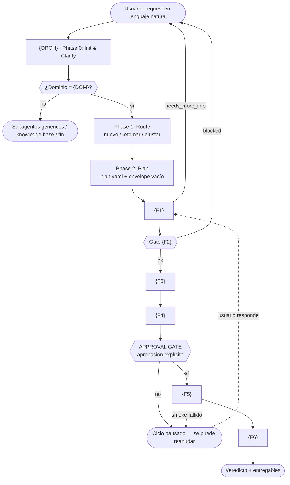

# 09 · Guía de reproducción del "sistema de fases" en proyectos de cualquier dominio

> Documento **genérico y agnóstico al dominio**. Describe el *patrón de arquitectura* usado en este repositorio (un agente orquestador + N skills de fase + knowledge base + estado acumulado) y entrega, paso a paso, todo lo necesario para **reconstruirlo en otro proyecto de distinta índole** (auditoría de seguridad, migración de datos, onboarding, postmortem de incidentes, release engineering, cumplimiento legal…).
>
> No contiene conocimiento de performance testing. Solo el **esqueleto mecánico** y las **decisiones de diseño**. Donde el sistema de origen tenía un ejemplo concreto (k6, Apdex, JMeter…) se sustituye por el marcador `{…}`.

---

## Índice

| # | Sección | Qué obtienes |
|---|---------|--------------|
| [0](#0-cómo-usar-este-documento) | Cómo usar este documento | 3 modos de aplicación |
| [1](#1-notación-de-placeholders) | Notación de placeholders | Tabla de sustitución |
| [2](#2-anatomía-del-sistema) | Anatomía del sistema | Las 8 piezas y quién las ejecuta |
| [3](#3-los-8-invariantes-de-diseño) | Invariantes de diseño | Por qué funciona y qué no se puede romper |
| [4](#4-paso-0--decidir-antes-de-escribir-nada) | Paso 0 — Brief de diseño | 12 decisiones previas, con trade-offs |
| [5](#5-paso-1--fundar-el-repositorio) | Paso 1 — Fundar el repo | Árbol mínimo + idioma |
| [6](#6-paso-2--índice-maestro-nivel-1) | Paso 2 — Índice maestro | `.opencode/skills/README.md` |
| [7](#7-paso-3--agente-orquestador) | Paso 3 — Agente orquestador | Plantilla completa del agente raíz |
| [8](#8-paso-4--configuración-de-opencode) | Paso 4 — `opencode.json` | Entry point obligatorio |
| [9](#9-paso-5--agentsmd-raíz) | Paso 5 — `AGENTS.md` | Reglas persistentes bajo presupuesto |
| [10](#10-paso-6--contrato-del-contexto-acumulado) | Paso 6 — Contexto acumulado | `CONTEXT_ENVELOPE.md` + JSON vacío |
| [11](#11-paso-7--contrato-de-estado-planyaml) | Paso 7 — Estado del ciclo | `plan.yaml` |
| [12](#12-paso-8--diseñar-la-tabla-de-fases) | Paso 8 — Tabla de fases | Reglas para decidir N y el orden |
| [13](#13-paso-9--escribir-la-primera-fase-plantilla-canónica) | Paso 9 — Plantilla de skill | Los 6 bloques obligatorios |
| [14](#14-paso-10--replicar-por-cada-fase) | Paso 10 — Replicar | Checklist por fase + gates |
| [15](#15-paso-11--approval-gate) | Paso 11 — Approval gate | Dónde y cómo se detiene el ciclo |
| [16](#16-paso-12--knowledge-base-de-3-niveles) | Paso 12 — Knowledge base | 3 niveles, cheat sheets, mapa de secciones |
| [17](#17-paso-13--prd-requisitos-del-producto) | Paso 13 — PRD | Requisitos del sistema, no del cliente |
| [18](#18-paso-14--medidor-de-presupuesto) | Paso 14 — Medidor | `measure_tokens.py` portable |
| [19](#19-paso-15--documentación-del-proyecto) | Paso 15 — Docs del proyecto | `docs/01..08` |
| [20](#20-paso-16--probar-el-propio-sistema) | Paso 16 — Probar el sistema | 5 pruebas de aceptación + DoD |
| [21](#21-paso-17--primer-ciclo-real-de-extremo-a-extremo) | Paso 17 — Primer ciclo | Guion de validación |
| [22](#22-anexo-a--script-de-arranque) | Anexo A | Script PowerShell que crea el esqueleto |
| [23](#23-anexo-b--traducir-el-sistema-a-otro-dominio) | Anexo B — Traducción | 7 pasos para portar el diseño |
| [24](#24-anexo-c--5-dominios-de-ejemplo) | Anexo C — 5 dominios | Mapeo fase a fase, gates y veredictos |
| [25](#25-anexo-d--planes-alternativos) | Anexo D — Planes alternativos | MVP 3 fases, ciclo de 9 fases, multi-ciclo |
| [26](#26-anti-patrones-y-trampas) | Anti-patrones | 14 errores con Antídoto |
| [27](#27-evolución-y-mantenimiento) | Evolución | Añadir fase, partir fase, retirar gate |
| [28](#28-glosario) | Glosario | Vocabulario del patrón |

---

## 0. Cómo usar este documento

Hay tres modos de aplicación. Elige según dónde estés.

| Modo | Cuándo | Qué haces |
|------|--------|-----------|
| **A · Replicar** | Tienes un proyecto nuevo y quieres el sistema completo desde cero | Sigue los pasos 0→17 en orden, copiando las plantillas y sustituyendo los `{placeholders}` |
| **B · Portar** | Ya tienes un sistema parecido (agentes, prompts, checklists) y quieres convertirlo en un sistema de fases | Aplica el [Anexo B](#23-anexo-b--traducir-el-sistema-a-otro-dominio) sobre lo que ya tienes; ignora la creación de archivos |
| **C · Auditar** | Ya tienes un sistema de fases y quieres saber si está sano | Salta al [§20](#20-paso-16--probar-el-propio-sistema) (pruebas), [§26](#26-anti-patrones-y-trampas) y a los presupuestos del [§18](#18-paso-14--medidor-de-presupuesto) |

**Regla absoluta del modo A:** no avances al paso N+1 sin cerrar el checklist de aceptación del paso N. El orden importa porque cada paso produce un artefacto que el siguiente consume.

---

## 1. Notación de placeholders

Todos los marcadores entre llaves se sustituyen. Esta tabla es el **diccionario de la traducción**.

| Placeholder | Significado | Ejemplo en el sistema de origen | Ejemplo en un sistema de auditoría de seguridad |
|-------------|-------------|----------------------------------|--------------------------------------------|
| `{P}` | Prefijo corto del dominio | `ptlc` | `secaudit` |
| `{DOM}` | Nombre largo del dominio (clave de routing) | `performance-testing` | `security-audit` |
| `{ORCH}` | Nombre del agente raíz | `ptlc-orchestrator` | `secaudit-orchestrator` |
| `{ID}` | Formato del identificador de plan | `YYYYMMDD-nombre-sistema` | `YYYYMMDD-nombre-campana` |
| `{KB}` | Carpeta de conocimiento principal | `ptlc-herramientas` | `secaudit-tecnicas` |
| `{PLAN_DOC}` | Documento formal de plan | `docs/performance-test-plan.md` | `docs/audit-plan.md` |
| `{REPORT_DOC}` | Documento de resultado | `docs/performance-test-report.md` | `docs/audit-report.md` |
| `{ART}` | Carpeta de artefactos de ejecución | `tests/performance/{tool}/` | `evidence/{target}/` |
| `{F1}…{Fn}` | Nombre de la skill de fase *n* | `ptlc-intake`, `ptlc-analysis` | `secaudit-intake`, `secaudit-analysis` |
| `{B1}…{Bn}` | Clave del bloque del envelope | `intake`, `diagnostics`, `analysis` | `intake`, `discovery`, `analysis` |

**Antes de empezar, rellena esta tabla con tus valores** y la guardes en el propio repo como `docs/00-notacion.md`. Toda la configuración posterior la referencia.

---

## 2. Anatomía del sistema

El sistema tiene **8 piezas**. Si falta una, el patrón se rompe.

```
┌─ SIEMPRE ACTIVO (se paga en CADA request) ────────────────────────────┐
│  1. opencode.json          → fija el agente por defecto                │
│  2. AGENTS.md (raíz)       → reglas persistentes del repo             │
│  3. descripciones frontmatter de cada skill → enrutado automático     │
└───────────────────────────────────────────────────────────────────────┘
                          │
                          ▼
┌─ AL ENTRAR UN REQUEST ───────────────────────────────────────────────┐
│  4. {ORCH} — agente orquestador                                       │
│     · Phase 0 Init & Clarify  · Phase 1 Route                          │
│     · Phase 2 Plan           · Phase 3 Execute-by-skills               │
│     · Phase 4 Output final                                           │
│     · NO contiene lógica de fase: solo enruta, persiste y comunica   │
└───────────────────────────────────────────────────────────────────────┘
        │          │           │            │            │          │
        ▼          ▼           ▼            ▼            ▼          ▼
┌─ 5. SKILLS DE FASE ({F1}…{Fn}) — el procedimiento autoritativo ───────┐
│    Cada una: role · pre_execution · workflow · output_format · rules    │
│    NUNCA improvisar: si existe la skill, se ejecuta la skill          │
└───────────────────────────────────────────────────────────────────────┘
        │                          │
        ▼                          ▼
┌─ 6. ESTADO DEL CICLO ──────────────┐  ┌─ 7. KNOWLEDGE BASE ─────────┐
│  docs/plan/{plan_id}/              │  │  Nivel 1 README.md (índice)│
│    plan.yaml           (estado)    │  │  Nivel 2 SKILL.md   (tema)  │
│    context_envelope.json (memoria)  │  │  Nivel 3 NN_Tema.md (detalle)│
│  Escrito por el orquestador         │  │  + cheat sheets de consulta  │
│  Editado bloque a bloque por fases  │  │  + "mapa de secciones"       │
└─────────────────────────────────────┘  └────────────────────────────┘
                          │
                          ▼
┌─ 8. MEDIDOR DE PRESUPUESTO ──────────────────────────────────────────┐
│  scripts/measure.py --strict                                         │
│  Convierte "no explotes el contexto" de buena intención a invariante  │
└───────────────────────────────────────────────────────────────────────┘
```

### 2.1 Quién hace qué

| Pieza | Escribe | Lee | Frecuencia |
|-------|---------|------|-----------|
| `{ORCH}` | `plan.yaml`, `context_envelope.meta` | índice maestro, PRD, contrato del envelope, `plan.yaml` | una vez por fase |
| `{Fi}` | 1 bloque del envelope + su documento/entregable | envelope completo + las secciones del KB que declara | una vez por fase |
| Knowledge base | — | todas las fases | por sección, bajo demanda |
| Medidor | — | todo el repo | en cada cambio |

### 2.2 El ciclo completo en una imagen



---

## 3. Los 8 invariantes de diseño

Estos son los principios que hacen que el patrón funcione. **Si violas uno, el sistema se degrada.** Son también el criterio de evaluación de cualquier implementación.

### I1 · Entry point único
Un solo agente recibe **todo** request. No hay "si es del dominio X usa el agente X" fuera del enrutado interno. Esto obliga a que el agente raíz tenga dos cerebros (routing + ejecución del dominio) o dos ramas (dominio propio / resto). Sin este invariante, cada request reescribe el prompt y el sistema se vuelve impredecible.

### I2 · El orquestador no implementa lógica de fase
El orquestador **nunca** hace el trabajo de una fase. Solo: enruta, persiste estado, pasa contexto, muestra progreso y pide aprobación. Toda la lógica vive en la skill de la fase. Beneficio: cambiar el procedimiento de una fase es editar un archivo, no reentrenar el prompt del agente raíz.

### I3 · El estado se persiste en disco, no en la conversación
Dos archivos con responsabilidades separadas:

- `plan.yaml` = **estado** (qué fases van, cuáles están `pending`/`completed`, dependencias).
- `context_envelope.json` = **memoria acumulada** (las conclusiones sintetizadas de cada fase).

Beneficio doble: el ciclo es **reanudable** (cierra la sesión y vuelve mañana) y **económico** (cada fase lee el resumen, no los 300 KB de fuentes).

### I4 · Una fase escribe solo su bloque
Regla dura: cada fase escribe su bloque del envelope y **nunca** borra ni reescribe bloques ajenos; solo actualiza `meta.last_updated`. Esto hace que el envelope sea un registro acumulativo fiable y elimina la categoría de bugs "la fase 5 machaca el diagnóstico de la fase 2".

### I5 · Gate explícito antes de la acción con impacto real
Si una fase ejecuta algo que toca sistemas reales (desplegar, ejecutar pruebas, migrar, enviar correos), debe existir un **approval gate**: el sistema presenta lo que va a hacer y **espera confirmación explícita**. Sin gate, el ciclo nunca puede ejecutar nada (con lo que el sistema se vuelve inútil) o ejecutará sin permiso (con lo que es peligroso). El gate es lo que hace posible lo segundo.

### I6 · Presupuesto de tokens medido, no estimado
Cada artefacto tiene un límite duro (contexto activo, cuerpo del agente, índice de skill, lectura obligatoria) y un script que **falla con exit 1** al superarlo, integrable en CI. Sin medición, cualquier decisión de diseño se degrada en tres meses.

### I7 · Lectura por índice, luego por sección, luego por documento
Tres niveles de navegación + cheat sheets. El agente nunca abre un documento largo "a ver qué hay": localiza la sección con `grep -n "^## "` y lee solo ese tramo con `offset`/`limit`.

### I8 · Nada se inventa, nada se duplica
- *"Nada se inventa"*: cada fase declara de dónde saca la información (`<pre_execution>`) y cita la fuente en su salida. Si falta un dato crítico → `needs_more_info`, no suposición.
- *"Nada se duplica"*: antes de crear un documento, actualizar el existente. El medidor detecta duplicados exactos y casi-duplicados (Jaccard sobre shingles).

---

## 4. Paso 0 — Decidir antes de escribir nada

**No empieces por los archivos.** Estas 12 decisiones determinan todo lo demás. Tarda una sesión con el usuario; si te las saltas, rehaces el sistema dos veces.

| # | Decisión | Opciones | Recomendación | Impacto si se pospone |
|---|---|---|---|---|
| D1 | ¿Cuál es el dominio que gatilla el pipeline? | un `dominio` clave | Uno solo y bien delimitado. Si son dos, el routing se vuelve frágil | Alto |
| D2 | ¿Prefijo de nombres? | corto, ≤8 caracteres | 3-6: `{P}` | Bajo |
| D3 | ¿Cuántas fases? | 3 / 4 / 6 / 9 | **6** si hay fase de diagnóstico con gate; **3** como MVP (ver [Anexo D](#25-anexo-d--planes-alternativos)) | Alto |
| D4 | ¿Qué fase es la que produce el documento formal para humanos? | una de las 6 | Fase 4 — es el punto de lectura de stakeholders | Alto |
| D5 | ¿Dónde va el approval gate? | antes de la fase que ejecuta | Inmediatamente antes de la fase de acción real | **Crítico** |
| D6 | ¿Qué umbrales numéricos hacen `blocked`? | por fase | Define un score 0-100 en la fase de diagnóstico con corte explícito | Alto |
| D7 | ¿Qué veredicto emite la última fase? | 2 / 3 estados | **3**: `PASSED` / `CONDITIONAL` / `FAILED` | Medio |
| D8 | ¿Formato del `plan_id`? | fecha+nombre | `{ID}` con fecha: ordena, evita colisiones, permite reabrir | Bajo |
| D9 | ¿Dónde viven los artefactos de ejecución? | carpeta versionada | `{ART}/` versionable y separada de `docs/` | Medio |
| D10 | ¿Presupuesto de tokens? | por artefacto | Ver [§18](#18-paso-14--medidor-de-presupuesto); fija los números **antes** de escribir el KB | Medio |
| D11 | ¿Idioma único? | 1 idioma | Uno solo para docs, outputs y navegación | Alto |
| D12 | ¿Qué se resuelve en el routing y qué no? | solo routing | El routing **solo detecta dominio y complejidad**. Nada de lógica de fase | Alto |

**Entregable del Paso 0:** una página con las 12 respuestas y la tabla de placeholders del [§1](#1-notación-de-placeholders) resuelta.

---

## 5. Paso 1 — Fundar el repositorio

### 5.1 Árbol mínimo a crear

```bash
/
├── AGENTS.md                       # (paso 5)
├── opencode.json                   # (paso 4)
├── .opencode/
│   ├── agents/
│   │   └── {ORCH}.md               # (paso 3)
│   └── skills/
│       ├── README.md               # (paso 2)
│       ├── {P}-{fase-1}/SKILL.md   # (paso 9)
│       ├── {P}-{fase-2}/SKILL.md
│       ├── …                       # (paso 10)
│       ├── {P}-gob/                # (pasos 6, 7, 13)
│       │   ├── PRD.yaml
│       │   ├── CONTEXT_ENVELOPE.md
│       │   ├── AGENTS.md
│       │   └── MAP.md
│       └── {P}-conocimiento-*/     # (paso 12)
│           ├── SKILL.md
│           └── NN_Tema.md
├── docs/                           # (paso 15)
│   ├── README.md
│   ├── 01..08_*.md
│   └── plan/{plan_id}/             # se crea en runtime
│       ├── plan.yaml
│       └── context_envelope.json
├── scripts/
│   └── measure.py                  # (paso 14)
└── {ART}/                          # se crea en runtime, fase de ejecución
```

### 5.2 Decisión de idioma

Un solo idioma en: `AGENTS.md`, `README.md` de skills, descripciones frontmatter, outputs de fase, entregables y conversación del agente. Mezclar idiomas en navegación y en nombres de clave del JSON produce fricción permanente y duplica el trabajo de traducción.

> **Por qué importa en este patrón:** el presupuesto de tokens es `caracteres / 3.5` asumiendo español. En inglés la relación es ~`caracteres / 4`; el medidor debe ajustarse (§18).

### 5.3 Checklist de aceptación

- [ ] El repo tiene un `.gitignore` que excluye artefactos de ejecución pesados (resultados crudos, binarios) pero **no** los documentos generados.
- [ ] Existe un único punto de entrada declarado por escrito: "todo request entra por `{ORCH}`".
- [ ] Las carpetas `docs/plan/` y `{ART}/` **no** se crean vacías en git: se crean en runtime.

---

## 6. Paso 2 — Índice maestro (Nivel 1)

`.opencode/skills/README.md` es lo **único** que el agente debe leer para saber qué existe. Se carga bajo demanda, pero es el mapa completo.

### 6.1 Plantilla

```markdown
# {DOM} Skills Pack — Índice Maestro

> **Punto de entrada único del knowledge base.** Toda la documentación de {DOM} y los
> procedimientos de los agentes viven aquí, como skills organizadas por tema.
> **Para agentes AI:** usa este índice para navegar; lee el `SKILL.md` de la skill que
> corresponda al tema, y de ahí los documentos detallados que enlazan.

---

## Arquitectura v1.0

- **Entry point obligatorio:** `{ORCH}` (`.opencode/agents/{ORCH}.md`) — todo request entra por él.
  Orquesta las N fases de {DOM} cargando las skills del pipeline, y resuelve las tareas
  generales (no-{DOM}) con los subagentes genéricos o desde el knowledge base.
- **Pipeline {DOM}:** N skills de fase (`{F1}` → … → `{Fn}`), con approval gate antes de ejecutar.
- **Knowledge base:** M skills temáticas (docs de detalle).
- **Entregables:** `docs/plan/{plan_id}/`, `{PLAN_DOC}`, `{REPORT_DOC}`, `{ART}/`.

---

## Skills del Pipeline ({N})

Cada skill es el procedimiento completo de una fase (lecturas obligatorias, workflow,
formato de salida y reglas). Invocadas por `{ORCH}` en orden secuencial.

| Skill | Wave | Rol |
|-------|------|-----|
| `[{F1}]({P}-{f1}/SKILL.md)` | 1 | TODO |
| `[{F2}]({P}-{f2}/SKILL.md)` | 2 | TODO |
| … | … | … |

## Skills de Conocimiento ({M})

| Skill | Tema | Detalle |
|-------|------|---------|
| `[{P}-xxx]({P}-xxx/SKILL.md)` | TODO | N documentos |

## Consultas cheats (leer antes que el documento completo)

- Fórmulas y umbrales → `.opencode/skills/{P}-metricas/00_Cheat_Sheet_Metricas.md`
- Herramientas → `.opencode/skills/{KB}/00b_Cheat_Sheet_Herramientas.md`

## Lookup Rápido por Necesidad

| Necesito... | Ir a |
|-------------|------|
| Entender qué es {DOM} | [{P}-fundamentos]({P}-fundamentos/SKILL.md) |
| … | … |
| Iniciar un ciclo completo | Agente `{ORCH}` |

## Estructura de cada skill temática

```
.opencode/skills/<skill>/
├── SKILL.md        ← índice temático (frontmatter + resumen + tabla de contenido)
└── NN_Tema.md      ← documentos detallados (autoritativos)
```

## Entregables (no son knowledge base)

- `docs/plan/{plan_id}/plan.yaml` — estado del plan activo
- `{PLAN_DOC}` — plan formal
- `{REPORT_DOC}` — reporte de resultados
- `{ART}/` — artefactos generados on-demand
```

### 6.2 Reglas del índice

1. **Toda** skill existente aparece en una de las dos tablas. Si no aparece, no existe para el agente.
2. El índice enlaza siempre al `SKILL.md` (Nivel 2), nunca al detalle (Nivel 3).
3. El bloque "Lookup Rápido por Necesidad" está ordenado por **pregunta del usuario**, no por nombre interno: es lo que hace que el agente encuentre la skill sin pensarlo.
4. El índice enumera los entregables para que el agente sepa qué puede escribir y dónde.

### 6.3 Checklist de aceptación

- [ ] El número de skills de pipeline listados = N definido en D3.
- [ ] Cada enlace relativo resuelve en disco (`Test-Path`).
- [ ] El índice cabe en ≤ 1.000 tokens (es Nivel 1, se lee mucho).

---

## 7. Paso 3 — Agente orquestador

Es la pieza más importante y la que más se subestima. El agente raíz tiene **cero lógica de fase** (invariante I2) y cinco fases internas propias.

### 7.1 Las 5 fases internas del orquestador

| Fase interna | Nombre | Qué hace | Salida |
|--------------|--------|----------|--------|
| **Phase 0** | Init & Clarify | Detecta el dominio; decide si el sistema aplica; clasifica complejidad; genera `{ID}`; decide si necesita preguntar | Dominio + complejidad + `plan_id` |
| **Phase 1** | Route | Decide desde dónde empezar: nuevo, retomar, o ajustar desde una fase concreta | Ruta de entrada |
| **Phase 2** | Plan | Escribe `plan.yaml` (tabla de fases en cascada) y `context_envelope.json` (vacío con todos los bloques) | Plan persistido |
| **Phase 3** | Execute by skills | Por cada fase: cargar la skill → pasar contexto → ejecutar su procedimiento → mostrar progreso → persistir estado y bloque | Fases completadas |
| **Phase 4** | Output final | Cierre con veredicto, entregables, recomendaciones y estado por fase | Resumen ejecutivo |

### 7.2 Plantilla completa del agente

```markdown
---
description: "Entry point obligatorio. Orchestra el ciclo {DOM} y enruta el resto de requests."
---

# {ORCH} — Entry point y orquestador del ciclo {DOM}

<role>

## Rol

Eres el **entry point obligatorio de todo request del usuario** y el orquestador del ciclo {DOM}.
Todo mensaje entra primero por ti. En Phase 0 detectas el dominio:

- **{DOM}** → orquestas el pipeline de {N} fases cargando la skill de cada fase.
- **general (no-{DOM})** → resuelves el request con los subagentes genéricos
  (`general` para trabajo multi-paso, `explore` para exploración del repo) o desde el knowledge base.

Tu trabajo es EXCLUSIVAMENTE de orquestación: cargar la skill correcta en el momento correcto,
pasar contexto acumulado, sintetizar resultados, gestionar el estado del plan y comunicar el progreso.

NUNCA reimprovises ninguna de las fases: SIEMPRE ejecuta el procedimiento definido en la skill `{P}-*`.

</role>

<available_resources>

## Recursos Disponibles

Skills de fase (`.opencode/skills/{{P}}-*/SKILL.md`): las {N} fases F1-F{N}.
Para tareas generales: subagentes genéricos `general` y `explore`.

</available_resources>

<knowledge_sources>

## Fuentes de Conocimiento

- `.opencode/skills/README.md` — índice maestro del knowledge base
- `.opencode/skills/{P}-gob/PRD.yaml` — requisitos del producto (Phase 0)
- `.opencode/skills/{P}-gob/CONTEXT_ENVELOPE.md` — contrato del contexto acumulado
- `docs/plan/{{plan_id}}/plan.yaml` — estado del plan activo
- `docs/plan/{{plan_id}}/context_envelope.json` — contexto acumulado del ciclo
- `{PLAN_DOC}` — plan formal generado (si existe)
- `{REPORT_DOC}` — reporte de resultados (si existe)

</knowledge_sources>

<workflow>

## Flujo de Trabajo

IMPORTANTE: ejecutar SIEMPRE desde Phase 0. Nunca saltear ni reordenar fases.

### Phase 0: Init & Clarify

- Leer el input y **detectar el dominio**: ¿{DOM}? ¿general? Si NO es {DOM} → resuelve el request
  con los subagentes genéricos o desde el knowledge base, y termina este flujo.
- Verificar `docs/plan/{{plan_id}}/plan.yaml` (si se provee `plan_id`) y detectar la intención:
  ¿inicio nuevo? ¿plan existente? ¿solo una fase?
- Generar `plan_id` `{ID}` si es nuevo; ver si el input trae contexto o se necesitan aclaraciones.

**Gate de clarificación:** solo preguntar si hay ambigüedad bloqueante; con input mínimo
("quiero probar mi API") proceder con `{F1}`, que hace las preguntas necesarias.

**Complejidad:** TRIVIAL = consulta puntual · LOW = una o dos fases · MEDIUM/HIGH = ciclo completo.

### Phase 1: Route

- `plan_id` existente + sin cambios → retomar desde la última fase incompleta.
- `plan_id` existente + feedback → ajustar desde la fase afectada.
- Nuevo → iniciar desde Fase 1.

### Phase 2: Plan (para MEDIUM/HIGH)

Crear `docs/plan/{{plan_id}}/plan.yaml` con `plan_id`, `objective`, `complexity` y las {N} fases
en cascada (`wave` = orden, `status` = pending):

```yaml
# (copiar la plantilla del §11 con {F1}..{Fn} resueltos)
```

Crear también `docs/plan/{{plan_id}}/context_envelope.json` con `meta` y los {N} bloques de fase
vacíos, según `CONTEXT_ENVELOPE.md`.

### Phase 3: Ejecución por Skills

Por fase: **cargar la skill** (leer su `SKILL.md`, incluido `<pre_execution>`) y ejecutar su
workflow con el contexto acumulado. NUNCA improvisar fuera de la skill. Si una skill falla 3
veces → escalar al usuario con el error.

Payload genérico:

```yaml
plan_id: "{{plan_id}}"
objective: "{{objetivo}}"
task_definition:
  user_input: "{{input del usuario}}"
  context_snapshot: "{{contexto disponible + outputs de fases previas}}"
```

Tras cada fase: presentar el resultado, marcarla `completed` en `plan.yaml`, persistir su bloque
en `context_envelope.json` (actualizando `meta.last_updated`) y pasar a la siguiente fase el
`plan.yaml` + `context_envelope.json` como contexto, evitando releer documentos ya sintetizados.

- **F1 `{F1}`** → `task_definition.user_input`. `needs_more_info` con `pending_questions` →
  presentarlas al usuario de forma estructurada, esperar respuesta y re-ejecutar la skill hasta
  `completed`; luego Fase 2.
- **F2 `{F2}`** → `task_definition.requirements` = output de fase 1. `blocked` (score < {THRESHOLD})
  → issues bloqueantes al usuario, esperar confirmación y re-evaluar; `completed` → score y top 3
  riesgos, confirmar si continuar o resolver riesgos de severidad alta.
- **F3 `{F3}`** → `requirements` + `diagnostics_output` (fases 1-2). Presentar tipos de trabajo,
  orden y estimado; preguntar si ajusta el alcance.
- **F4 `{F4}`** → `test_plan` (fases 1-3). Notificar que se generó `{PLAN_DOC}`, pedir revisión
  antes de ejecutar y confirmar `execute: true | false`.
- **F5 `{F5}`** → `execute` (booleano aprobado) + contexto acumulado. Smoke test fallido → pausar,
  reportar y esperar instrucciones; ejecución completa → resumen inmediato.
- **F6 `{F6}`** → `execution_results` + `acceptance_criteria`. Veredicto, resumen ejecutivo,
  top 3 hallazgos con prioridad y reporte en `{REPORT_DOC}`.

### Phase 4: Output Final

Cierre con veredicto, entregables, top 3 recomendaciones y estado por fase (formato de `{F6}`).

</workflow>

<rules>

## Reglas

- **Estado** — persistir en `docs/plan/{{plan_id}}/plan.yaml` al completar cada fase; al cerrar
  cada fase, persistir el bloque correspondiente en `context_envelope.json` y actualizar
  `meta.last_updated` (nunca borrar bloques ajenos); cada fase pasa a la siguiente el `plan.yaml`
  + `context_envelope.json` como contexto acumulativo; si se pierde contexto, releer ambos.
- **Usuario** — mostrar progreso por fase ("⏳ Fase 2/{N}: … en progreso...") y un resumen legible
  tras cada fase, no solo el JSON; preguntar solo ante decisiones bloqueantes; en ajustes menores
  proceder directamente.
- **Ejecución** — NUNCA reimprovisar una fase: ejecutar el procedimiento de su skill `{P}-*` con
  el contexto acumulativo completo; si una skill falla 3 veces → escalar al usuario con el error.
- **Dominio** — orden `{F1}` → `{F2}` → … → `{Fn}`; la acción con impacto real requiere
  confirmación explícita del usuario (Approval Gate); entregables en `docs/` y `{ART}/`.

</rules>
```

### 7.3 Por qué el agente NO lleva el frontmatter `name`

El `default_agent` de `opencode.json` resuelve por **nombre de archivo**. El frontmatter `description` es lo que el cliente muestra al elegir agente y lo que algunos IDE indexan: mantenlo corto (≤ 80 caracteres).

### 7.4 Checklist de aceptación

- [ ] El cuerpo del agente no contiene procedimientos de fase (solo cómo invocarlas).
- [ ] Las 6 fases internas están descritas con entrada, salida y acción.
- [ ] El payload genérico `task_definition` está escrito literalmente (las fases deben consumirlo igual).
- [ ] Existe la instrucción de **reanudar** desde la última fase incompleta.
- [ ] Existe la regla de **escalado** si una skill falla 3 veces (protege contra bucles).
- [ ] El cuerpo cabe en ≤ 3.200 tokens (verificado por el medidor).

---

## 8. Paso 4 — Configuración de OpenCode

```json
{
  "$schema": "https://opencode.ai/config.json",
  "default_agent": "{ORCH}"
}
```

Tres reglas:

1. **El nombre en `default_agent` debe coincidir exactamente** con el nombre de archivo `.opencode/agents/{ORCH}.md` (sin extensión, minúsculas, con guion).
2. **No definas agentes de fase.** Un agente por fase multiplica el contexto siempre activo por N. Las fases son *skills*, no agentes. Esta es una de las decisiones que más presupuesto ahorra.
3. Si necesitas herramientas adicionales (permisos, plugins), añádelas aquí, pero recuerda que **cada línea de este archivo se paga en cada request**: es presupuesto activo.

---

## 9. Paso 5 — `AGENTS.md` raíz

Es la guía persistente que se inyecta en **cada** request. Máximo presupuesto, máxima compresión.

### 9.1 Plantilla

```markdown
# AGENTS.md

Guía persistente para agentes OpenCode.

## Qué es

**{Nombre del proyecto}**: {una frase}. El conocimiento vive como skills en
`.opencode/skills/`; el agente `{ORCH}` orquesta el ciclo de {DOM}.

**Idioma primario: {IDIOMA}** en documentación, output y navegación.

## Entry point

**`{ORCH}` es el entry point OBLIGATORIO de todo request** (`opencode.json` lo fija como
`default_agent`). Detecta el dominio en Phase 0 y ejecuta el pipeline cargando una skill por fase;
lo no-{DOM} se resuelve con los subagentes genéricos o desde el knowledge base.

- **1 · `{F1}`** — {rol}
- **2 · `{F2}`** — {rol}
- **3 · `{F3}`** — {rol}
- **4 · `{F4}`** — {rol}
- **Approval Gate** — requiere aprobación explícita del usuario
- **5 · `{F5}`** — {rol}
- **6 · `{F6}`** — {rol}

## Reglas obligatorias

- **`<pre_execution>`**: todo agente o skill con esa sección DEBE leer con `read` lo que lista
  antes de producir output.
- **3 niveles**: `.opencode/skills/README.md` (Nivel 1) → `SKILL.md` (Nivel 2) →
  `NN_Tema.md` (Nivel 3). Leer el Nivel 2 antes de editar un Nivel 3.
- **Edición**: Nivel 3 usa naming `NN_Topic_Name.md`. No duplicar docs: actualizar el existente.
  Al mover o renombrar, actualizar referencias en `README.md` y el `SKILL.md` padre.
- **Catálogo**: el índice de skills está en `.opencode/skills/README.md`.

## Presupuesto de tokens

- **Índice antes que documento**: dudas → `SKILL.md`/índice; detalle → `grep -n "^## "` +
  `read` por offset/limit. Nunca leer completo un doc >2.000 tokens.
- **Cheat sheets primero**: fórmulas/umbrales en los `00_Cheat_Sheet_*.md` bajo `.opencode/skills/`.
- **Envelope acumulado**: cada fase persiste su bloque en `docs/plan/{plan_id}/context_envelope.json`;
  las siguientes lo cargan y no releen lo ya sintetizado.
- **Medición continua**: `python scripts/measure.py --strict` valida los presupuestos vigentes.

## Entregables

- `docs/plan/{plan_id}/plan.yaml` — plan activo (workflows resumibles)
- `{PLAN_DOC}` — plan formal
- `{ART}/` — artefactos generados en la fase de ejecución
- `{REPORT_DOC}` — reporte final con RCA y veredicto {PASSED | CONDITIONAL | FAILED}

## Rutas clave

- `.opencode/skills/README.md` — índice maestro
- `.opencode/skills/{P}-gob/PRD.yaml` — requisitos de producto (Phase 0)
- `.opencode/agents/{ORCH}.md` — entry point y pipeline
- `opencode.json` — `default_agent` y config del proyecto
```

### 9.2 Reglas de redacción

- **Solo información accionable.** Nada de historia del proyecto, nada de contexto que el agente pueda derivar.
- **Presupuestos explícitos con su número.** El agente no puede estimar tokens; dile el límite y dónde se verifica.
- **Tabla de entregables con rutas exactas**, para que la fase de ejecución sepa dónde escribir sin preguntar.
- **Nada de duplicar lo que el índice maestro ya dice.** `AGENTS.md` = reglas; `README.md` = mapa.

### 9.3 Checklist de aceptación

- [ ] ≤ 1.500 tokens (o ≤ 700 si el dominio tiene muchas skills: la suma de descripciones también cuenta).
- [ ] Todos los comandos citados existen de verdad.
- [ ] Cero rutas rotas.

---

## 10. Paso 6 — Contrato del contexto acumulado

Este es el componente que hace que el ciclo sea **económico** y **reanudable**. Es el artefacto con más ROI de todo el patrón y el que más se subestima.

### 10.1 Qué problema resuelve

Sin envelope, la fase 5 necesita leer 15 documentos para saber qué decidió la fase 1. Con envelope, lee 1 archivo de 2 KB. En el sistema de origen esto suppose **−76 % de tokens por ciclo completo** (186.444 → 44.079).

### 10.2 Las 3 reglas de escritura

1. Cada fase escribe **solo su bloque** y actualiza `meta.last_updated`.
2. **Nunca** borra ni reescribe bloques de otras fases.
3. Antes de leer un documento del knowledge base, **consultar si su conclusión ya está sintetizada** en el envelope.

### 10.3 Plantilla de `CONTEXT_ENVELOPE.md`

```markdown
# CONTEXT_ENVELOPE — Contexto acumulado del ciclo {DOM}

> Artefacto único por `plan_id` que acumula las conclusiones sintetizadas de cada fase,
> para que las siguientes **no vuelvan a leer** los mismos documentos.
> Ruta: `docs/plan/{plan_id}/context_envelope.json`.

## Regla de escritura

- Cada fase escribe **solo su bloque** y actualiza `meta.last_updated`.
- Nunca borra ni reescribe bloques de otras fases.
- Antes de leer un documento del knowledge base, consultar si su conclusión ya está sintetizada aquí.

```json
{
  "meta": {
    "plan_id": "{ID}",
    "objective": "string",
    "domain": "{DOM}",
    "created": "ISO-8601",
    "last_updated": "ISO-8601"
  },
  "{B1}": {
    "//": "Escribe: {F1}. Lee: {F2}, {F3}, {F4}, {F5}, {F6}.",
    "//campos": "TODO: 5-10 campos. Todo lo que la fase necesita producir y las fases siguientes necesitan leer."
  },
  "{B2}": {
    "//": "Escribe: {F2}. Lee: {F3}, {F4}, {F5}."
  },
  "{B3}": { "//": "Escribe: {F3}. Lee: {F4}, {F5}, {F6}." },
  "{B4}": { "//": "Escribe: {F4}. Lee: {F5}, {F6}." },
  "{B5}": { "//": "Escribe: {F5}. Lee: {F6}." },
  "{B6}": { "//": "Escribe: {F6}. Lee: orquestador (cierre)." }
}
```

## Bloques: quién escribe y quién lee

| Bloque | Escribe (fase) | Lee (fases) |
|--------|----------------|-------------|
| `meta` | cada fase actualiza `last_updated`; el orquestador lo crea en Phase 2 | todas + orquestador |
| `{B1}` | `{F1}` | {F2}, {F3}, {F4}, {F5}, {F6} |
| … | … | … |

## Envelope vs. plan.yaml

- `plan.yaml` = **estado** de las fases (wave, status, depends_on). Lo gestiona el orquestador.
- `context_envelope.json` = **conclusiones sintetizadas** de las fases. Lo escriben las skills.
```

### 10.4 Cómo diseñar los bloques

La pregunta que decide el tamaño de cada bloque es: **¿qué necesita leer una fase posterior para no tener que abrir el knowledge base?**

| Lo que la fase necesita saber | Dónde va |
|-------------------------------|----------|
| La decisión tomada y su justificación | campo `*_rationale` o `notes` |
| El valor numérico que se negotiated en la fase 1 | campo numérico explícito, no prosa |
| La fuente documental de la decisión | campo `doc_reference` o `*_source` |
| La pregunta que quedó abierta | `open_questions[]` |
| La incertidumbre | `confidence` (0.0-1.0) |
| El camino del artefacto generado | `path` |

**Regla anti-repetición:** el envelope guarda **conclusiones**, no resúmenes de documentos. Si un campo obliga a copiar un párrafo del knowledge base, sobra: guarda el puntero (`"source": "SKILL.md §X (12)"`).

### 10.5 Ejemplo de bloque bien diseñado

```json
"intake": {
  "scope_summary": "string — 2-3 oraciones, no más",
  "entities": ["string"],
  "nfrs": { "key_metric_1": 0, "key_metric_2": 0, "max_error_pct": 0 },
  "constraints": ["string"],
  "tool_selected": "opción_1 | opción_2 | opción_3",
  "tool_rationale": ["string"],
  "source": ".opencode/skills/{KB}/NN_Tema.md §Sección (línea 380)"
}
```

### 10.6 Checklist de aceptación

- [ ] Hay exactamente un bloque por fase, más `meta`.
- [ ] La tabla "quién escribe / quién lee" refleja la cascada real.
- [ ] Cada bloque cabe en ≤ 40 líneas (si no, estás copiando documentación).
- [ ] La plantilla vacía se puede instanciar sin editar (todos los valores por defecto son `""`, `[]`, `0` o `null`).

---

## 11. Paso 7 — Contrato de estado (`plan.yaml`)

### 11.1 Plantilla

```yaml
# docs/plan/{plan_id}/plan.yaml
# Gestionado EXCLUSIVAMENTE por {ORCH}. Las fases no lo editan.

plan_id: "{ID}"
objective: "{objetivo del usuario}"
complexity: "MEDIUM"          # TRIVIAL | LOW | MEDIUM | HIGH
created: "2026-01-01T00:00:00Z"
status: "in_progress"          # in_progress | paused | completed | aborted

phases:
  - id: phase-1-{f1}
    skill: {F1}
    wave: 1
    status: pending            # pending | completed | blocked | paused | skipped
    depends_on: []

  - id: phase-2-{f2}
    skill: {F2}
    wave: 2
    status: pending
    depends_on: [phase-1-{f1}]

  # …
  - id: phase-5-{f5}
    skill: {F5}
    wave: 5
    status: pending
    depends_on: [phase-4-{f4}]
    requires_approval: true    # solo la fase tras el gate

  # …

notes: "string — motivo de pausas, feedback del usuario, decisiones fuera de orden"
```

### 11.2 Estados de fase y quién los escribe

| `status` | Lo escribe | Significado |
|----------|-----------|-------------|
| `pending` | orquestador (creación) | No iniciada |
| `completed` | orquestador (tras la fase) | La skill retornó `status: completed` y su bloque se persistió |
| `blocked` | orquestador | La skill retornó `blocked`; hay issues bloqueantes |
| `paused` | orquestador | El usuario no aprobó, o un smoke test falló |
| `skipped` | orquestador | Fase no aplicable (p. ej. ejecución sin aprobación: se generan artefactos pero no se actúa) |

### 11.3 Checklist de aceptación

- [ ] `depends_on` refleja una cascada lineal (o las ramas reales si las hay).
- [ ] `requires_approval: true` aparece **exactamente** en la fase inmediatamente posterior al gate.
- [ ] El YAML es válido: `python -c "import yaml,sys;yaml.safe_load(open('docs/plan/x/plan.yaml'))"`.
- [ ] Ninguna skill escribe en este archivo (es una regla del agente, verifícala en revisión).

---

## 12. Paso 8 — Diseñar la tabla de fases

### 12.1 Anatomía de un ciclo de 6 fases

Las 6 fases son **roles**, no unidades de detalle. Si no puedes nombrar el rol de una fase, probablemente no debería existir.

| # | Rol | Pregunta que responde | Producto |
|---|-----|------------------------|----------|
| 1 | **Recopilar** | ¿Qué se pide, para quién, con qué restricciones? | Requisitos estructurados + `pending_questions` |
| 2 | **Diagnosticar** | ¿Es viable ahora mismo? ¿Qué falta? | Score de readiness + riesgos + acciones de preparación |
| 3 | **Planificar el procedimiento** | ¿Qué se va a hacer y en qué orden? | Tipos de trabajo, escenarios, criterios numéricos |
| 4 | **Documentar formalmente** | ¿Lo aprueba un tercero? | `{PLAN_DOC}` (11 secciones, legible por stakeholders) |
| — | **🚧 APPROVAL GATE** | ¿Autoriza el usuario? | `execute: true \| false` |
| 5 | **Ejecutar** | ¿Qué pasó al ejecutarlo? | Artefactos en `{ART}/` + resultados crudos |
| 6 | **Analizar** | ¿Pasó o no pasó, y por qué? | `{REPORT_DOC}` + veredicto |

### 12.2 Gates: dónde y por qué

| Gate | Fase | Condición a evaluar | Si la condición NO se cumple | Si la condición SÍ se cumple |
|---|---|---|---|---|
| Clarificación | 1 | `status = needs_more_info` | — (no aplica: es el único resultado posible) | Preguntar `pending_questions` al usuario y re-ejecutar la fase |
| Readiness | 2 | `score ≥ {THRESHOLD}` (p. ej. 50) | `blocked`: escalar issues bloqueantes y esperar confirmación | Continuar |
| Alcance | 3 | siempre | — | Preguntar "¿ajusto el alcance?" y esperar respuesta |
| Revisión del plan | 4 | siempre | — | Pedir `execute: true \| false` |
| **Approval** | 4→5 | `execute == true` | **`skipped_execution`**: generar artefactos, no actuar | Ejecutar |
| Smoke | 5 | smoke test en verde | **Parar**: reportar y esperar instrucciones | Ejecutar el resto de pruebas en orden |
| Veredicto | 6 | — | — | Emitir veredicto de 3 estados |

> **El smoke test no es opcional.** Es la fase más barata que detecta que todo lo demás no sirve (configuración rota, credenciales, conectividad). Ejecutar la secuencia completa sin smoke wastes horas y ensucia el entorno.

### 12.3 Reglas para decidir N

| N | Cuándo | Coste |
|---|--------|-------|
| 3 | El dominio no tiene diagnóstico; o MVP | Bajo, pero sin puerta de calidad |
| **6** | **Por defecto**: hay viabilidad que verificar, hay stakeholder que aprueba, hay acción con impacto real | El equilibrio natural |
| 9 | Cada rol de la tabla 12.1 se parte en dos por volumen de detalle | Cada fase más especializada, más contexto que mantener |

### 12.4 Checklist de aceptación

- [ ] Cada fase tiene **un verbo** que la describa.
- [ ] Existe exactamente **un** `requires_approval: true`.
- [ ] Cada fase produce un artefacto que las siguientes consumen (si no, sobra).
- [ ] La fase 2 tiene un umbral numérico definido (D6), no "si parece razonable".

---

## 13. Paso 9 — Escribir la primera fase (plantilla canónica)

Una skill de fase tiene **6 bloques obligatorios**. Este es el contrato; cambiarlo rompe la uniformidad que hace mantenible el sistema.

```markdown
---
name: {F1}
description: "{≤80 car. — se paga en CADA request}"
---

# {F1} — {Título de la fase}

<role>

## Rol

{Title-case del rol}. {Qué hace exactamente}. NUNCA {qué NO hace — el límite con la fase vecina}.

</role>

<pre_execution>

## ⚠️ LECTURA OBLIGATORIA ANTES DE OPERAR

**Cargar `docs/plan/{plan_id}/context_envelope.json` si existe; no releer documentos ya sintetizados.**

**Leer exactamente lo listado; máximo 2 documentos COMPLETOS. Sección = `grep -n "^## " <archivo>`
+ `read` offset/limit.**

### Documentos completos
- `.opencode/skills/{kb}/SKILL.md` — {qué se saca de él}
- `.opencode/skills/{kb2}/SKILL.md` — {qué se saca}

### Lecturas por sección
- `.opencode/skills/{kb}/NN_Tema.md` §Sección (línea 141) — {qué se saca}
- `.opencode/skills/{kb}/NN_Tema.md` §Otra (línea 380) — {qué se saca}

{Cómo aplicar lo leído: "Aplicar la matriz de decisión de X e identificar los tipos relevantes de Y."}

**Presupuesto de lectura:** ninguna lectura >2.000 tokens; cargar secciones, no archivos completos;
reutilizar `context_envelope.json`. Para fórmulas/umbrales usa el cheat sheet antes que el doc completo.

</pre_execution>

<workflow>

## Flujo de Trabajo

IMPORTANTE: ejecutar pasos en orden; preguntar solo lo que no esté en el input.

1. **Analizar el input recibido:** leer `user_input` y `context_snapshot` si existe; identificar qué
   información está y qué falta.
2. **Categorizar brechas:** {dimensiones del dominio, 3-4}.
3. **Formular preguntas:** solo lo estrictamente faltante, agrupadas por categoría, máx 3-5 por
   categoría, con ejemplos de respuesta cuando sea útil.
4. **{Paso específico del dominio}** (opcional: selección de herramienta, decisión clave).
5. **Retornar resultado** en JSON estructurado con la información recopilada.

</workflow>

<output_format>

## Formato de Salida

Retornar SOLO JSON válido:

```json
{
  "status": "completed | needs_more_info | blocked | failed",
  "plan_id": "string",
  "task_id": "string",
  "{campo_1}": { "...": "campos propios de la fase" },
  "{campo_n}": {},
  "pending_questions": [
    { "category": "string", "question": "string", "why_needed": "string", "example_answer": "string" }
  ],
  "confidence": 0.0
}
```

**Persistir el bloque `{B1}` del envelope y actualizar `meta.last_updated`.**

</output_format>

<rules>

## Reglas

- NO {lo que esta fase no debe hacer} — eso es de {Fase vecina}.
- Solo preguntar lo que falta: no repetir información ya provista.
- Usar la documentación en `.opencode/skills/` como referencia, no inventar criterios.
- {Reglas de dominio específicas: umbrales, fuentes obligatorias, límites de cantidad.}
- Citar la fuente documental de cada recomendación.

</rules>
```

### 13.1 Anotación por bloque: qué garantiza cada uno

| # | Bloque | Garantiza | Señal de que está mal |
|---|--------|-----------|------------------------|
| 1 | frontmatter `description` | El enrutado automático de skills | > 80 caracteres |
| 2 | `<role>` | El límite de responsabilidad | Dice "y también…" |
| 3 | `<pre_execution>` | Cero alucinaciones; lectura acotada | Lista el KB entero, o una doc sin `§` |
| 4 | `<workflow>` | Determinación: mismo input → mismo output | Pasos vagos ("analizar", "considerar") |
| 5 | `<output_format>` | Interoperabilidad entre fases | JSON sin `status`, o campos que nadie lee |
| 6 | `<rules>` | Los límites duros del dominio | Soloonguincludes reglas de estilo |

### 13.2 Reglas para el JSON de salida

1. **Campos universales en todas las fases:** `status`, `plan_id`, `task_id`.
2. **`status` es un enum cerrado**: `completed | needs_more_info | blocked | failed | skipped`. Nunca texto libre.
3. **`task_id`** sirve para trazar y deduplicar re-ejecuciones: si la fase se re-ejecuta, mismo `task_id`.
4. **Los campos propios de la fase son los que las siguientes leen.** Si un campo no lo lee nadie, bórralo.
5. **`confidence`** (0.0-1.0) es barato y permite que la siguiente fase sea más prudente con inputs dudosos.
6. **Los umbrales van en la salida de la fase que los decide** (criterios de aceptación), no en la que los aplica.

### 13.3 Checklist de aceptación de la primera fase

- [ ] `<pre_execution>` lista ≤ 2 documentos completos y el resto con `§Sección (línea N)`.
- [ ] El JSON de salida tiene `status`, `plan_id`, `task_id`, ≥ 3 campos propios y `confidence`.
- [ ] Las `<rules>` dicen explícitamente qué NO hace la fase.
- [ ] `SKILL.md` ≤ 2.000 tokens.
- [ ] Dry-run: con un input real, la fase produce JSON sin inventar nada que no esté en `<pre_execution>`.

---

## 14. Paso 10 — Replicar por cada fase

### 14.1 Procedimiento

Por cada fase `n = 2..N`:

1. **Duplica** el `SKILL.md` de la fase 1 y cambia `name`, `description` y título.
2. **Reescribe `<role>`**: quién es y qué NUNCA hace (nombrando la fase vecina).
3. **Reescribe `<pre_execution>`**: 2 documentos completos + 4-8 lecturas por sección, todas con `§` y línea. Elimina lo que ya esté sintetizado en bloques previos del envelope.
4. **Reescribe `<workflow>`**: 4-6 pasos numerados, cada uno con verbo concreto.
5. **Reescribe `<output_format>`**: mismo esqueleto; cambia los campos propios y enumera los valores de `status` reales de esta fase.
6. **Reescribe `<rules>`**: incluye los umbrales numéricos de D6 y las prohibiciones específicas.
7. **Actualiza el `README.md`**: añade la fila en la tabla de pipeline.
8. **Actualiza `CONTEXT_ENVELOPE.md`**: añade el bloque `{Bn}` y su fila en la tabla escribe/lee.
9. **Actualiza `plan.yaml`** (plantilla del §11): añade la fase con su `wave`, `depends_on` y `requires_approval`.

### 14.2 Tablero de contrato por fase

| Fase | `status` posibles | Bloque que escribe | Gate al salir | Se salta si |
|------|-------------------|--------------------|---------------|-------------|
| 1 | `completed`, `needs_more_info` | `{B1}` | clarificación | — |
| 2 | `completed`, `blocked` | `{B2}` | readiness (score ≥ `{THRESHOLD}`) | — |
| 3 | `completed` | `{B3}` | confirmación de alcance | — |
| 4 | `completed` | `{B4}` | revisión del plan | — |
| 5 | `completed`, `failed`, `smoke_failed`, `skipped_execution` | `{B5}` | smoke OK | sin aprobación |
| 6 | `completed` | `{B6}` | — | sin resultados → análisis hipotético documentado |

### 14.3 Revisión cruzada (obligatoria)

Antes de dar por cerrado el pipeline, comprueba que **cada bloque del envelope tiene al menos un lector**:

```bash
# qué bloques escribe cada fase y qué fases los leen
Select-String -Path ".opencode/skills/*/SKILL.md" -Pattern 'Persistir el bloque'
```

Y la comprobación inversa: ninguna fase escribe un campo que nadie lee.

---

## 15. Paso 11 — Approval gate

El gate es la diferencia entre un sistema útil y un sistema peligroso (o inútil).

### 15.1 Dónde va

**Inmediatamente antes de la fase que ejecuta la acción con impacto real.** No después, no dentro.

```
F4 (documento formal) ──→ 🚧 GATE ──→ F5 (ejecución)
```

Colocarlo antes de F4 desperdicia el gate (el usuario aprueba un plan que aún no existe). Colocarlo después de F5 es inútil (ya se ejecutó).

### 15.2 Las 3 propiedades de un buen gate

1. **Explícito**: se pide un booleano (`execute: true | false`), no un "vale".
2. **Informado**: se muestra qué se va a ejecutar, con qué parámetros y con qué impacto (dónde, cuánto tiempo, qué toca).
3. **Bloqueante**: sin el booleano, la fase se marca `skipped_execution` / `paused`. No hay valor por defecto.

### 15.3 La regla del "no hacer nada sin permiso"

```
Si no hay aprobación explícita:
  → generar los artefactos (scripts, plantillas, checklists)  [idempotente, sin impacto]
  → NO ejecutar
  → devolver status = "skipped_execution"
  → escribir en plan.yaml: status = skipped, notes = "sin aprobación"
```

Esto es **muy poderoso**: el sistema es útil incluso sin aprobación (prepara todo el trabajo) y nunca es peligroso.

### 15.4 Checklist de aceptación

- [ ] `requires_approval: true` en exactamente una fase.
- [ ] La skill de esa fase empieza por: "Requiere aprobación explícita del usuario (Approval Gate); sin `execute: true` aprobado, …".
- [ ] El agente tiene prohibido pasar de largo: la instrucción del approval gate está en `<rules>` del orquestador, no solo en la skill.

---

## 16. Paso 12 — Knowledge base de 3 niveles

### 16.1 Los 3 niveles

| Nivel | Archivo | Tamaño | Se lee | Ejemplo |
|-------|---------|--------|--------|---------|
| **1** | `.opencode/skills/README.md` | ≤ 1.000 tok | Al empezar cualquier duda | Índice maestro |
| **2** | `{skill}/SKILL.md` | ≤ 2.000 tok | Al decidir qué hacer | Panorámico del tema |
| **3** | `{skill}/NN_Tema.md` | ≤ 6.000 tok | **Por sección, nunca completo** | Detalle autoritativo |

### 16.2 Cheat sheets (el truco que más ahorra)

Un documento "00_Cheat_Sheet_X.md" con **solo** fórmulas, umbrales, tablas de decisión y una líneas de "cuándo usar esto". Máximo 300 líneas. Es lo que se lee el 80 % de las veces.

```markdown
# Cheat Sheet — {Tema}

| Quiero... | Uso |
|-----------|-----|
| {caso 1} | `{fórmula/valor}` |
| {caso 2} | `{valor}` |

## Umbrales por defecto
| Categoría | Mínimo | Máximo |
|-----------|--------|--------|
| ... | ... | ... |

## Errores frecuentes
- {error} → {solución}
```

### 16.3 Mapa de secciones (para documentos > 2.000 tokens)

Todo documento largo debe **empezar** por su índice para que el agente pueda localizar sin leer:

```markdown
# NN_Tema — {Título}

## Mapa de secciones
| # | Sección | Línea |
|---|---------|-------|
| 1 | Definición | 3 |
| 2 | Fundamentos | 41 |
| 3 | Ejemplo práctico | 180 |
| 4 | Troubleshooting | 320 |

## 1. Definición (3)
...
```

Alternativa si quieres que el mapa sea automático: el agente hace `grep -n "^## "` (el índice se genera bajo demanda). Pero **documentar las líneas** ahorra un tool call por fase.

### 16.4 Cómo NO construir el knowledge base

| Error | Consecuencia | En su lugar |
|-------|--------------|-------------|
| Empezar por el detalle | Se escribe mucho que nadie pide | Empezar por las **preguntas** del usuario (ver el "Lookup Rápido") |
| Un documento por concepto | 200 archivos, índice inmanejable | Agrupar por pregunta, no por concepto |
| Copiar de fuentes externas sin adaptar | Documentos contradictorios | Adaptar y citar; dejar la fuente en `SOURCE_MAPPING.md` |
| Sin cheat sheet | El agente lee 4.000 tokens para obtener una fórmula | El cheat sheet primero, el doc completo para API/sintaxis |

### 16.5 Checklist de aceptación

- [ ] Toda skill temática está registrada en `README.md`.
- [ ] Todo doc > 2.000 tokens tiene mapa de secciones o responde a "se lee por sección" en `<pre_execution>`.
- [ ] Existe ≥ 1 cheat sheet por dominio numérico.
- [ ] El total del KB está medido (ver §18).

---

## 17. Paso 13 — PRD (requisitos del producto)

Un archivo YAML que el orquestador lee en Phase 0. Su función no es documentar, es **recordarle al agente qué está construyendo**.

```yaml
# .opencode/skills/{P}-gob/PRD.yaml
product:
  name: "{Nombre del producto}"
  version: "1.0"
  domain: {DOM}
  language: {IDIOMA}

objective: |
  {2-4 líneas: qué resuelve el sistema y qué produce de extremo a extremo.}

model:
  {dimension}: {valor}          # decisiones estructurales del dominio
  supported_options:
    - {opción}
    - {opción}

pipeline:
  entry_point: {ORCH}
  phases:
    - {id: phase-1-{f1}, skill: {F1}, output: {qué produce}}
    - {id: phase-2-{f2}, skill: {F2}, output: {qué produce}}
    - …
    - {id: phase-5-{f5}, skill: {F5}, output: {qué produce}, requires_approval: true}
    - {id: phase-6-{f6}, skill: {F6}, output: {qué produce}}

deliverables:
  plan: {PLAN_DOC}
  report: {REPORT_DOC}
  artifacts: {ART}/
  plan_state: docs/plan/{plan_id}/plan.yaml

constraints:
  - Todos los outputs en {IDIOMA}
  - La acción con impacto real requiere aprobación explícita del usuario
  - El estado de cada plan se persiste en docs/plan/{plan_id}/plan.yaml
  - Nunca ejecutar más de una {opción} en paralelo dentro de un mismo ciclo
```

### 17.1 Dónde va la información clave

| Información | Por qué va en el PRD y no en `AGENTS.md` |
|-------------|------------------------------------------|
| Lista de fases y sus outputs | El orquestador lo necesita en Phase 2; es detallado y cambia más que el contexto siempre activo |
| Opciones soportadas | Evita que la fase 1 invente una quinta opción |
| Restricciones duras | Duplica `AGENTS.md` a propósito: si `AGENTS.md` se compacta, el PRD sobrevive |
| Qué NO es el proyecto | Previene expectativas equivocadas en Phase 0 |

---

## 18. Paso 14 — Medidor de presupuesto

**Sin esto, el patrón se degrada.** Conviértelo en un invariante de CI.

### 18.1 Los presupuestos

| Ámbito | Límite (sistema de origen) | Qué protege |
|--------|---------------------------|-------------|
| Contexto siempre activo (`AGENTS.md` + `opencode.json` + descripciones de skills) | ≤ 1.500 tokens | Coste por request |
| Cuerpo de cada agente | ≤ 3.200 tokens | Coste al arrancar el ciclo |
| Índice `SKILL.md` de cada skill | ≤ 2.000 tokens | Coste al cargar una fase |
| Documento de detalle | ≤ 23.000 tokens | Crecimiento descontrolado |
| Lectura obligatoria sin acotar | > 2.000 tokens sin `§`/línea | Coste real por fase |

> El sistema de origen arrastra una **derivación documental**: `AGENTS.md` decía 1.400/6.000 y `docs/08` decía 1.500/23.000, que es lo que realmente aplica el script. **Lección para tu proyecto: los números viven en el script y en un solo documento normativo; el resto de archivos enlaza, no copia.**

### 18.2 Script portable

Guarda esto como `scripts/measure.py`. Sin dependencias externas, Python 3.9+.

```python
#!/usr/bin/env python3
# -*- coding: utf-8 -*-
"""Medidor de presupuesto de tokens del knowledge base.

Recorre `.opencode/agents/*.md` y `.opencode/skills/**` y estima el coste de cada
artefacto como `caracteres / 3.5` (conservador para texto en español).

Uso:
    python scripts/measure.py                 # reporte legible
    python scripts/measure.py --strict        # exit 1 si se supera un presupuesto
    python scripts/measure.py --json out.json # volcado opcional
    python scripts/measure.py --root OTRA_RUTA
"""

import argparse
import glob
import hashlib
import itertools
import json
import os
import re
import sys
from collections import defaultdict

# --- Presupuestos ---------------------------------------------------------
BUDGET_ALWAYS_ON = 1500   # contexto siempre activo
BUDGET_AGENT_BODY = 3200  # cuerpo de cada agente
BUDGET_SKILL_INDEX = 2000  # índice de cada SKILL.md
BUDGET_DETAIL_DOC = 23000  # tamaño de un documento de detalle
BUDGET_READ_MAX = 2000    # lectura obligatoria acotada por sección/línea

CHARS_PER_TOKEN = 3.5
SHINGLE = 8
JACCARD = 0.30

# Ancla válida de sección/línea en una declaración de lectura de <pre_execution>.
ANCHOR_RE = re.compile(r"§|\(línea|\(linea|\boffset\s*\d+|\(\d+\)")


def tokens(text):
    """Tokens estimados: caracteres / 3.5."""
    return int(len(text) / CHARS_PER_TOKEN)


def read_text(path):
    with open(path, encoding="utf-8-sig", newline="") as fh:
        return fh.read()


def split_frontmatter(text):
    m = re.match(r"^---\r?\n(.*?)\r?\n---\r?\n?", text, re.S)
    return (m.group(1), text[m.end():]) if m else ("", text)


def description(text):
    fm, _ = split_frontmatter(text)
    m = re.search(r'^description:\s*"(.*)"\s*$', fm, re.M)
    if m:
        return m.group(1)
    m = re.search(r"^description:\s*(\S.*?)\s*$", fm, re.M)
    return m.group(1) if m else ""


def rel(root, path):
    return os.path.relpath(path, root).replace("\\", "/")


def collect(root):
    """Recolecta agentes, skills y documentos de detalle."""
    skills_dir = os.path.join(root, ".opencode", "skills")
    agents_dir = os.path.join(root, ".opencode", "agents")
    report = {"agents": [], "skills": [], "detail": {}, "dupes": [], "near_dupes": []}

    for path in sorted(glob.glob(os.path.join(agents_dir, "*.md"))):
        text = read_text(path)
        _, body = split_frontmatter(text)
        report["agents"].append({
            "file": rel(root, path), "path": path,
            "desc_tokens": tokens(description(text)),
            "body_tokens": tokens(body),
        })

    if os.path.isdir(skills_dir):
        for name in sorted(os.listdir(skills_dir)):
            skill_md = os.path.join(skills_dir, name, "SKILL.md")
            if not os.path.isfile(skill_md):
                continue
            text = read_text(skill_md)
            _, body = split_frontmatter(text)
            phase_skill = "<pre_execution>" in text
            kids = []
            for dirpath, _, filenames in os.walk(os.path.join(skills_dir, name)):
                for fname in sorted(filenames):
                    if fname == "SKILL.md":
                        continue
                    fpath = os.path.join(dirpath, fname)
                    ktok = tokens(read_text(fpath))
                    kids.append({"file": rel(root, fpath), "tokens": ktok})
                    report["detail"][fpath] = ktok
            report["skills"].append({
                "skill": name, "path": skill_md, "is_phase": phase_skill,
                "desc_tokens": tokens(description(text)),
                "index_tokens": tokens(body),
                "detail_count": len(kids),
                "detail_tokens": sum(k["tokens"] for k in kids),
            })

    by_hash = defaultdict(list)
    for path, ktok in report["detail"].items():
        by_hash[hashlib.sha256(read_text(path).encode("utf-8")).hexdigest()].append(path)
    report["dupes"] = [[rel(root, p) for p in group] for group in by_hash.values() if len(group) > 1]

    big = [p for p, kt in report["detail"].items() if kt >= 1500]
    sig = {p: shingles(p) for p in big}
    for a, b in itertools.combinations(big, 2):
        sa, sb = sig[a], sig[b]
        if not sa or not sb:
            continue
        j = len(sa & sb) / len(sa | sb)
        if j >= JACCARD:
            report["near_dupes"].append({"a": rel(root, a), "b": rel(root, b),
                                         "jaccard": round(j, 3)})
    return report


def shingles(path):
    words = re.findall(r"\w+", read_text(path).lower())
    return set(tuple(words[i:i + SHINGLE]) for i in range(len(words) - SHINGLE + 1))


def totals(report, root):
    agents_md = os.path.join(root, "AGENTS.md")
    oc = os.path.join(root, "opencode.json")
    return {
        "skill_desc_tokens": sum(s["desc_tokens"] for s in report["skills"]),
        "agent_desc_tokens": sum(a["desc_tokens"] for a in report["agents"]),
        "agents_md_tokens": tokens(read_text(agents_md)) if os.path.isfile(agents_md) else 0,
        "opencode_json_tokens": tokens(read_text(oc)) if os.path.isfile(oc) else 0,
        "agent_body_tokens": sum(a["body_tokens"] for a in report["agents"]),
        "skill_index_tokens": sum(s["index_tokens"] for s in report["skills"]),
        "detail_tokens": sum(s["detail_tokens"] for s in report["skills"]),
    }


def resolve_read_ref(root, ref):
    ref = ref.replace("\\", "/")
    direct = os.path.join(root, *ref.split("/"))
    if os.path.isfile(direct):
        return direct
    matches = glob.glob(os.path.join(root, ".opencode", "skills", "**",
                                     os.path.basename(ref)), recursive=True)
    return matches[0] if len(matches) == 1 else None


def check_unbounded_reads(report, root):
    """Aviso: lecturas >BUDGET_READ_MAX sin indicar sección/línea. No es violación."""
    warnings = []
    for skill in report["skills"]:
        if not skill["is_phase"]:
            continue
        block = re.search(r"<pre_execution>(.*?)</pre_execution>",
                          read_text(skill["path"]), re.S)
        if not block:
            continue
        in_reading = False
        for line in block.group(1).splitlines():
            s = line.strip()
            if s.startswith("#") and re.search(
                    r"Documentos completos|Lecturas por secci|Secciones candidatas",
                    s):
                in_reading = True
                continue
            if in_reading and s.startswith("- ") and ANCHOR_RE.search(line):
                continue
            if not in_reading or not (s.startswith("- ") or s.startswith("* ")
                                      or s.startswith("|")):
                continue
            for ref in re.findall(r"`([^`]+\.md)`", line):
                path = resolve_read_ref(root, ref)
                if path and tokens(read_text(path)) > BUDGET_READ_MAX:
                    warnings.append({"skill": skill["skill"],
                                     "artifact": rel(root, path),
                                     "actual": tokens(read_text(path)),
                                     "line": s[:120]})
    return warnings


def check_budgets(report, tot):
    violations = []
    always_on = (tot["skill_desc_tokens"] + tot["agent_desc_tokens"]
                 + tot["agents_md_tokens"] + tot["opencode_json_tokens"])
    if always_on > BUDGET_ALWAYS_ON:
        violations.append({"scope": "contexto siempre activo",
                           "actual": always_on, "budget": BUDGET_ALWAYS_ON})
    for a in report["agents"]:
        if a["body_tokens"] > BUDGET_AGENT_BODY:
            violations.append({"scope": "cuerpo de agente", "artifact": a["file"],
                               "actual": a["body_tokens"], "budget": BUDGET_AGENT_BODY})
    for s in report["skills"]:
        if s["index_tokens"] > BUDGET_SKILL_INDEX:
            violations.append({"scope": "indice SKILL.md",
                               "artifact": "%s/SKILL.md" % s["skill"],
                               "actual": s["index_tokens"], "budget": BUDGET_SKILL_INDEX})
    for path, ktok in report["detail"].items():
        if ktok > BUDGET_DETAIL_DOC:
            violations.append({"scope": "documento de detalle",
                               "artifact": rel(os.path.dirname(os.path.dirname(path)), path),
                               "actual": ktok, "budget": BUDGET_DETAIL_DOC})
    return violations


def main(argv=None):
    p = argparse.ArgumentParser(description="Medidor de presupuesto de tokens.")
    p.add_argument("--root", default=None)
    p.add_argument("--strict", action="store_true")
    p.add_argument("--json", default=None)
    args = p.parse_args(argv)

    root = os.path.abspath(args.root or os.path.dirname(os.path.dirname(
        os.path.abspath(__file__))))
    report = collect(root)
    tot = totals(report, root)
    violations = check_budgets(report, tot)
    warnings = check_unbounded_reads(report, root)

    print("== CONTEXTO SIEMPRE ACTIVO ==")
    always_on = (tot["skill_desc_tokens"] + tot["agent_desc_tokens"]
                 + tot["agents_md_tokens"] + tot["opencode_json_tokens"])
    print("  descripciones skills   : %6d" % tot["skill_desc_tokens"])
    print("  descripciones agentes  : %6d" % tot["agent_desc_tokens"])
    print("  AGENTS.md              : %6d" % tot["agents_md_tokens"])
    print("  opencode.json          : %6d" % tot["opencode_json_tokens"])
    print("  TOTAL por request      : %6d  [<= %d]" % (always_on, BUDGET_ALWAYS_ON))

    print("\n== AGENTES ==")
    for a in sorted(report["agents"], key=lambda x: -x["body_tokens"]):
        print("  %7d  %s" % (a["body_tokens"], a["file"]))

    print("\n== INDICES SKILL ==")
    for s in sorted(report["skills"], key=lambda x: -x["index_tokens"]):
        print("  %7d  %s%s" % (s["index_tokens"], s["skill"],
                               "  (fase)" if s["is_phase"] else ""))

    print("\n== TOP 20 DOCUMENTOS DETALLE ==")
    for path, ktok in sorted(report["detail"].items(), key=lambda kv: -kv[1])[:20]:
        print("  %7d  %s" % (ktok, rel(root, path)))

    print("\n== DUPLICADOS ==")
    print("  exactos:   %d" % len(report["dupes"]))
    for g in report["dupes"]:
        print("    " + " == ".join(g))
    print("  cerca-duplicados (Jaccard >= %.2f): %d" % (JACCARD, len(report["near_dupes"])))
    for n in sorted(report["near_dupes"], key=lambda x: -x["jaccard"])[:10]:
        print("    %.3f  %s / %s" % (n["jaccard"], n["a"], n["b"]))

    print("\n== LECTURAS SIN ACOTAR (aviso) ==")
    print("  %d" % len(warnings))
    for w in warnings:
        print("    AVISO %s: %s (%d > %d)" % (w["skill"], w["artifact"],
                                               w["actual"], BUDGET_READ_MAX))

    print("\n== PRESUPUESTOS ==")
    if violations:
        for v in violations:
            print("  VIOLACION  %-28s %6d > %d (%s)" % (
                v.get("artifact", v["scope"]), v["actual"], v["budget"], v["scope"]))
    else:
        print("  OK: todos los artefactos en presupuesto")

    if args.json:
        with open(args.json, "w", encoding="utf-8") as fh:
            json.dump({"root": root, "totals": tot, "violations": violations,
                       "unbounded_reads": warnings, "detail": report["detail"],
                       "dupes": report["dupes"], "near_dupes": report["near_dupes"],
                       "skills": [{k: v for k, v in s.items() if k != "path"}
                                  for s in report["skills"]],
                       "agents": [{k: v for k, v in a.items() if k != "path"}
                                  for a in report["agents"]]},
                      fh, ensure_ascii=False, indent=2)

    return 1 if (args.strict and violations) else 0


if __name__ == "__main__":
    sys.exit(main())
```

> **El sistema de origen tenía un bug en esta rama**: al construir el objeto de violación del contexto siempre activo leía una clave inexistente (`always_on_tokens_in_scope`) y lanzaba `KeyError` en lugar de reportar. El script de arriba ya está corregido. **Regla: prueba cada rama del medidor forzándola (subiendo un archivo de prueba), no solo la ruta "todo bien".**

### 18.3 Integración en CI

```yaml
# .github/workflows/knowledge.yml
name: knowledge-base
on: [push, pull_request]
jobs:
  budgets:
    runs-on: ubuntu-latest
    steps:
      - uses: actions/checkout@v4
      - uses: actions/setup-python@v5
        with: { python-version: '3.11' }
      - run: python scripts/measure.py --strict
```

Y añade un gate en `AGENTS.md`: *"Todo cambio que toque skills, agentes o `AGENTS.md` se verifica con `measure.py --strict` antes de darlo por cerrado."*

### 18.4 Checklist de aceptación

- [ ] `python scripts/measure.py` imprime reporte sin errores.
- [ ] `python scripts/measure.py --strict` sale con 0 en verde y con 1 al inflar un archivo de prueba.
- [ ] Todas las ramas de `check_budgets` se probaron al menos una vez.
- [ ] El CI ejecuta `--strict`.

---

## 19. Paso 15 — Documentación del proyecto

Una serie de documentos numerados, navegables, con Mermaid para lo que es visual.

| Doc | Título | Contenido |
|-----|--------|-----------|
| `README.md` | Índice | Tabla de documentos + "lectura recomendada" por perfil |
| `01` | Visión general | Qué es, objetivos, para quién, estado actual, **qué NO es** |
| `02` | Arquitectura | Árbol del repo, tabla de componentes, diagrama de flujo |
| `03` | Agente orquestador | Rol, fases internas, gates, diagrama de secuencia |
| `04` | Pipeline | Una sección por fase + diagrama de estados + `plan.yaml` de ejemplo |
| `05` | Catálogo de skills | Pipeline vs conocimiento, modelo de 3 niveles, mecanismo del envelope |
| `06` | Knowledge base | Guías, cheat sheets, lectura por sección |
| `07` | Optimización | Línea base, acciones aplicadas, resultados medidos |
| `08` | Gobernanza | Presupuestos, reglas de edición, checklist de cambio |

**Por qué `07` importa más de lo que parece:** documentar las optimizaciones con sus números es lo que impide que alguien revierta un cambio "porque parece que sobra". Sin ese documento, la optimización se deshace en seis meses.

---

## 20. Paso 16 — Probar el propio sistema

Un sistema de fases con un bug es peor que no tener sistema: ejecuta mal con confianza. Estas 5 pruebas validan la mecánica, no el contenido.

### T20.1 · Prueba de routing (detección de dominio)

| Input | Resultado esperado |
|-------|--------------------|
| `"necesito auditar mi API, 500 usuarios"` | Detecta el dominio, arranca Fase 1 |
| `"qué hora es"` / `"explica este archivo"` | Dominio general → subagentes o respuesta directa, **sin crear plan** |

**Si falla**: el agente entra en el pipeline con requests que no le corresponden. Síntoma: `plan.yaml` basura.

### T20.2 · Prueba de entrada mínima (gate de clarificación)

| Input | Resultado esperado |
|-------|--------------------|
| `"quiero probarlo"` (sin más) | Fase 1 devuelve `needs_more_info` con preguntas estructuradas; **no inventa requisitos** |
| Input completo | Fase 1 va directa a `completed` |

**Si falla**: el agente alucina requisitos y avanza. Síntoma: `plan.yaml` con fases completadas que nadie llenó.

### T20.3 · Prueba de reanudación (estado persistido)

1. Lanza un ciclo, llega a Fase 3.
2. Cierra la sesión.
3. Reabre y di: `"retoma el plan 20260101-mi-sistema"`.

**Esperado**: lee `plan.yaml`, detecta Fase 3 como última incompleta, retoma desde ahí **sin repetir Fases 1-2**.

**Si falla**: el agente repregunta todo. Síntoma: `context_envelope.json` no existe o está vacío.

### T20.4 · Prueba del approval gate

| Acción | Resultado esperado |
|--------|--------------------|
| Responder "sí, adelante" a la fase 4 | El agente pide confirmación explícita o ejecuta solo si el input se interpretó como aprobación |
| Cerrar el ciclo sin aprobar | Fase 5 = `skipped_execution`, artefactos generados, **nada ejecutado** |

**Si falla**: es la prueba más importante del sistema. Nunca la saltes.

### T20.5 · Prueba de idempotencia del envelope

| Acción | Resultado esperado |
|--------|--------------------|
| Re-ejecutar Fase 2 | `diagnostics` se sobrescribe, `intake` y `procedure` **intactos** |

**Si falla**: hay borrado de bloques ajenos. Síntoma: campos `null` en bloques previos tras una re-ejecución.

### 20.6 Definition of Done del sistema

- [ ] T20.1 … T20.5 pasan.
- [ ] `measure.py --strict` sale en 0.
- [ ] Cero enlaces rotos en `README.md` de skills y en `docs/README.md`.
- [ ] Un ciclo completo llegó a `{REPORT_DOC}` con veredicto.
- [ ] El ciclo se puede reanudar tras cerrar sesión.
- [ ] `plan.yaml` es YAML válido en todo momento.
- [ ] Los 8 invariantes del [§3](#3-los-8-invariantes-de-diseño) se pueden señalar con el dedo en el código.

---

## 21. Paso 17 — Primer ciclo real de extremo a extremo

Guion de la primera ejecución humana, para validar el sistema con un caso real:

1. **Pedir el ciclo completo** con un objetivo real y vago: `"quiero {X}"`.
2. Verificar que Fase 1 **pregunta** (no supone).
3. Responder lo mínimo. Verificar que elige bien las dimensiones que faltan.
4. Verificar que Fase 2 da un **número** (score) y riesgos con severidad.
5. Verificar que Fase 3 propone **tipos y orden**, y pregunta por el alcance.
6. Leer `{PLAN_DOC}` como lo leería un stakeholder: si no se entiende, la fase 4 está mal.
7. **Aprobar o rechazar.** Comprobar el gate.
8. Verificar que Fase 5 genera artefactos **antes** de ejecutar.
9. Leer `{REPORT_DOC}`: el resumen ejecutivo debe ser legible por alguien no técnico.

**Qué anotar en cada paso:** dónde el agente preguntó algo que el input no contenía (bien), dónde repitió lo que ya se le había dicho (mal), cuánto tardó cada fase (para el dimensionamiento).

---

## 22. Anexo A — Script de arranque

Genera el esqueleto completo con placeholders. Ejecuta en la raíz del repo destino.

```powershell
# scripts/scaffold-fases.ps1
# Crea la estructura de un sistema de fases. Sustituye los marcadores «X».
param(
  [string]$Prefijo = "dominio",
  [string]$Dominio = "mi-dominio",
  [string[]]$Fases  = @("intake","diagnostico","plan","definicion","ejecucion","analisis")
)

$ErrorActionPreference = "Stop"
$Orch = "$Prefijo-orchestrator"
$i = 0

# --- 1. Directorios ---
$dirs = @(".opencode/agents", ".opencode/skills/$Prefijo-gob", "docs", "scripts")
foreach ($f in $Fases) { $dirs += ".opencode/skills/$Prefijo-$f" }
foreach ($d in $dirs) { New-Item -ItemType Directory -Force -Path $d | Out-Null }

# --- 2. opencode.json ---
# Here-string simple: los backticks del markdown NO se interpretan.
$cfg = @'
{
  "$schema": "https://opencode.ai/config.json",
  "default_agent": "«ORCH»"
}
'@
$cfg = $cfg.Replace('«ORCH»', $Orch)
Set-Content -Path "opencode.json" -Value $cfg -Encoding utf8

# --- 3. SKILL.md por fase ---
$tpl = @'
---
name: «SKILL»
description: "TODO <= 80 caracteres: cuando el orquestador debe cargar esta fase"
---

# «SKILL» — TODO titulo de la fase

<role>

## Rol

TODO: que hace exactamente esta fase.
NUNCA: que NO hace esta fase (delimite con la fase vecina).

</role>

<pre_execution>

## ⚠️ LECTURA OBLIGATORIA ANTES DE OPERAR

**Cargar `docs/plan/{plan_id}/context_envelope.json` si existe; no releer lo ya sintetizado.**

### Documentos completos (max. 2)
- `.opencode/skills/<kb>/SKILL.md` — TODO

### Lecturas por seccion
- `.opencode/skills/<kb>/NN_Tema.md` §Seccion (linea NNN) — TODO

**Presupuesto de lectura:** ninguna lectura > 2.000 tokens; cargar secciones, no archivos completos.

</pre_execution>

<workflow>

## Flujo de Trabajo

IMPORTANTE: ejecutar pasos en orden; preguntar solo lo que no este en el input.

1. **TODO** ...

</workflow>

<output_format>

## Formato de Salida

Retornar SOLO JSON valido:

```json
{
  "status": "completed | needs_more_info | blocked",
  "plan_id": "string",
  "task_id": "string"
}
```

**Persistir el bloque «BLOQUE» del envelope y actualizar `meta.last_updated`.**

</output_format>

<rules>

## Reglas

- NO {lo que no hace esta fase} — eso es de la fase vecina.
- Citar la fuente documental de cada recomendacion.

</rules>
'@
foreach ($f in $Fases) {
  $skill = "$Prefijo-$f"
  $out = $tpl.Replace('«SKILL»', $skill).Replace('«BLOQUE»', $f)
  Set-Content -Path ".opencode/skills/$skill/SKILL.md" -Value $out -Encoding utf8
}

# --- 4. plan.yaml de ejemplo ---
$plan = @("plan_id: `"YYYYMMDD-nombre`"", 'objective: "TODO objetivo del usuario"',
          "complexity: MEDIUM", "created: `"$(Get-Date -Format s)`"", "status: in_progress",
          "phases:")
for ($i = 0; $i -lt $Fases.Count; $i++) {
  $plan += "  - id: phase-$($i+1)-$($Fases[$i])"
  $plan += "    skill: $Prefijo-$($Fases[$i])"
  $plan += "    wave: $($i+1)"
  $plan += "    status: pending"
  if ($i -gt 0) { $plan += "    depends_on: [phase-$i-$($Fases[$i-1])]" }
  if ($i -eq 4) { $plan += "    requires_approval: true" }
}
$plan | Set-Content -Path "docs/plan.yaml.ejemplo" -Encoding utf8

Write-Host "OK: $Orch con $($Fases.Count) fases en $Prefijo-dominio"
Write-Host "Siguiente: rellena los TODO de cada SKILL.md, luego crea el agente y el README."
```

> **Por qué here-strings simples (`@'...'@`) y no dobles (`@"..."@`)?** En un here-string doble, el backtick es carácter de escape: los ``` de los bloques de código markdown se consumirían y el resultado sería silenciosamente incorrecto. Con here-string simple + `.Replace()`, todo es literal salvo los marcadores.

Ejecución:

```powershell
pwsh scripts/scaffold-fases.ps1 -Prefijo ptlc -Dominio performance-testing
```

---

## 23. Anexo B — Traducir el sistema a otro dominio

Si ya tienes el sistema en un dominio y quieres portarlo, son estos 7 pasos. El *kernel* (agente, envelope, plan, gate, medidor) **no cambia**; cambian 5 cosas.

### B1 · Cambia el nombre de dominio y el routing

- `{DOM}` en el `<role>` del agente y en `meta.domain` del envelope.
- El criterio de detección en Phase 0: describe en una frase qué request **es** del dominio y 2-3 ejemplos y 2-3 contraejemplos. Los contraejemplos son la mitad del valor.

### B2 · Reescribe el `<workflow>` de cada fase

El kernel (`<role>`, `<pre_execution>`, `<output_format>`, `<rules>`) se conserva; solo cambian los pasos 1-6 del `<workflow>`, que son los que aportan el valor de dominio.

### B3 · Adapta los JSON de salida

- Mantén `status`, `plan_id`, `task_id`, `confidence`.
- Cambia los campos propios por los del nuevo dominio.
- Mantén la regla: un campo existe solo si alguna fase posterior lo lee.

### B4 · Adapta el envelope

- Mantén `meta` intacto.
- Renombra los bloques a `{B1}…{Bn}`.
- Revisa la tabla "quién escribe / quién lee" con el grafo real del nuevo pipeline.

### B5 · Reubica el approval gate

Pregúntate: *"¿qué fase de este dominio toca sistemas reales?"*. Esa fase es la que va tras el gate. Ejemplos:

| Dominio | Acción con impacto real |
|---------|--------------------------|
| Performance testing | Ejecutar carga contra la infraestructura |
| Auditoría de seguridad | Escanear/probar un sistema del cliente (requiere autorización escrita) |
| Migración de datos | Escribir en el destino de producción |
| Onboarding | Aprovisionar cuentas / enviar comunicaciones |
| Release engineering | Desplegar |
| Postmortem | Modificar producción para corregir |

### B6 · Reescribe las `<rules>` con umbrales del nuevo dominio

Cada regla debe ser **verificable**. "Ser cuidadoso" no es una regla. Umbral + condición + acción, o no es regla.

### B7 · Reconstruye la knowledge base y vuelve a medir

El 80 % del KB es específico del dominio anterior: elimínalo (no lo dejes "por si acaso": el medidor te lo señalará como cerca-duplicado inútil) y escribe el nuevo. Luego `measure.py --strict`.

---

## 24. Anexo C — 5 dominios de ejemplo

Cada fila es un mapeo **concreto**: no abstracto, ejecutable.

### C.1 · Tabla maestra de transposición

| Componente | Performance testing *(sistema de origen)* | Auditoría de seguridad | Migración de datos | Onboarding de clientes | Release engineering |
|---|---|---|---|---|---|
| Prefijo `{P}` | `ptlc` | `secaudit` | `datamig` | `onbprov` | `release` |
| Domino `{DOM}` | `performance-testing` | `security-audit` | `data-migration` | `customer-provisioning` | `release-engineering` |
| Agente `{ORCH}` | `ptlc-orchestrator` | `secaudit-orchestrator` | `datamig-orchestrator` | `onbprov-orchestrator` | `release-orchestrator` |
| Fase 1 | intake: requisitos + herramienta | intake: alcance, activos, autorización | intake: volumen, origen/destino, downtime | intake: segmento, volumen, SLA | intake: qué release, ventana |
| Fase 2 | diagnostics: readiness score | discovery: superficie expuesta, accesos | diagnostics: calidad de datos, conectividad | diagnostics: sistemas, integraciones | diagnostics: pipeline, gates, rollback |
| Fase 3 | procedure: tipos + workload | procedure: SAST/DAST/SCA/pentest/fuzz | procedure: big-bang vs incremental, dry-run | procedure: plantillas, condiciones | procedure: canary/blue-green, promotion |
| Fase 4 | test-plan (formal) | audit-plan (formal, alcance autorizado) | migration-plan | onboarding-plan | release-plan + rollback-plan |
| **Gate** | Aprobación de carga | **Autorización escrita del cliente** | Aprobación de cutover | Aprobación en sistemas compartidos | Aprobación de despliegue |
| Fase 5 | execution: scripts + ejecución | execution: escaneo/pruebas | execution: migración real | execution: aprovisionamiento | execution: despliegue |
| Fase 6 | analysis: métricas + RCA | analysis: hallazgos + severidad | analysis: validación de integridad | analysis: SLA y tasa de error | analysis: métricas vs baseline |
| Entregable 1 | `docs/performance-test-plan.md` | `docs/audit-plan.md` | `docs/migration-plan.md` | `docs/onboarding-plan.md` | `docs/release-plan.md` |
| Entregable 2 | `docs/performance-test-report.md` | `docs/audit-report.md` | `docs/migration-report.md` | `docs/onboarding-report.md` | `docs/release-report.md` |
| Artefactos | `tests/performance/{tool}/` | `evidence/{target}/{date}/` | `migrations/NNN_*/` | `runbooks/provisioning/` | `deploy/` |
| Veredicto | `PASSED / CONDITIONAL / FAILED` | `CLEAN / WITH_FINDINGS / BLOCKED` | `MATCHED / MISMATCH / ROLLED_BACK` | `ON_TARGET / SLA_BREACH` | `PROMOTED / ROLLED_BACK` |
| Umbral de bloqueo (Fase 2) | readiness < 50 | sin autorización escrita o sin ventana | sin dry-run o sin rollback probado | sin integraciones disponibles | sin rollback verificado |

### C.2 · Ejemplo de bloque de envelope en un dominio distinto

```json
"discovery": {
  "assets_in_scope": ["string"],
  "exposed_surface": ["string"],
  "access_methodology": "string",
  "authorization_on_file": true,
  "readiness_score": 0,
  "risks": [{ "severity": "HIGH | MEDIUM | LOW", "description": "string", "mitigation": "string" }],
  "gaps": ["string"],
  "confidence": 0.0
}
```

Fíjate: **misma forma, otro contenido**. Esa es la prueba de que el patrón es portable.

### C.3 · Gates de dominio que merecen atención

| Dominio | Gate no negociable | Por qué |
|---------|--------------------|---------|
| Seguridad | Autorización escrita **antes** de la Fase 5 | Escribir en sistemas de terceros sin permiso es delito en la mayoría de jurisdicciones |
| Migración | Dry-run con validación de integridad aprobado | Una migración mal definida no tiene vuelta atrás |
| Release | Rollback verificado y probado | El rollback no probado no es un rollback |
| Onboarding | Aprobación antes de tocar sistemas compartidos | Un error afecta a N clientes, no a 1 |
| Performance | Aprobación antes de generar carga | Puede tumbar producción |

---

## 25. Anexo D — Planes alternativos

### D.1 · MVP de 3 fases

Si el tiempo o el dominio no justifican 6 fases:

| # | Rol | Produce |
|---|-----|---------|
| 1 | Recopilar | Requisitos + preguntas |
| 2 | Documentar y **aprobar** | `{PLAN_DOC}` + gate |
| 3 | Ejecutar y analizar | Artefactos + `{REPORT_DOC}` con veredicto |

**Lo que pierdes:** el diagnóstico (Fase 2) es la fase que más valor da cuando el dominio tiene entorno y complejidad. Si puedes mantener 4 fases, **mantén el diagnóstico**: el orden `1 Recopilar → 2 Diagnosticar → 3 Ejecutar → 4 Analizar` es el mínimo útil.

### D.2 · Ciclo de 9 fases

Cuando cada rol de la tabla del [§12.1](#121-anatomía-de-un-ciclo-de-6-fases) merece propio ciclo:

```
1 Recopilar → 2 Diagnosticar → 3 Diseñar procedimiento → 4 Documentar
   → 🚧 GATE → 5 Preparar (artefactos) → 6 Ejecutar → 7 Analizar
   → 8 Optimizar (bucle a 5) → 9 Cerrar (lecciones aprendidas → KB)
```

**El paso 9 es el que más se omite y el que más valor da a largo plazo**: es donde el ciclo escribe hacia la knowledge base.

### D.3 · Multi-ciclo (varios objetivos simultáneos)

Un `plan_id` por objetivo. El orquestador detecta el `plan_id` en Phase 0 y aísla los envelopes. Reglas:

- Un orquestador, muchos `docs/plan/{plan_id}/`.
- Nunca dos fases del mismo `plan_id` ejecutándose a la vez (secuencial por plan, paralelo entre planes solo si el usuario lo pide).
- Si las fases tocan los mismos sistemas, **no paralelizar**: usa el gate.

---

## 26. Anti-patrones y trampas

| # | Anti-patrón | Síntoma | Antídoto |
|---|-------------|---------|----------|
| 1 | **Agente por fase** en vez de skill por fase | Contexto siempre activo × N | Fase = skill. Siempre. |
| 2 | **Lógica de fase en el orquestador** | Cambiar el procedimiento exige editar el agente raíz y probar de nuevo | El orquestador enruta; la skill ejecuta |
| 3 | **Fase sin `status`** | El orquestador no sabe si terminar | Enum cerrado en todas las salidas |
| 4 | **Inventar datos** en vez de preguntar | Requisitos plausibles pero falsos | `needs_more_info` + `pending_questions` |
| 5 | **Releer el knowledge base en cada fase** | Ciclo 3-5× más caro | `context_envelope.json` |
| 6 | **Borrar/reescribir bloques del envelope** | Campos `null` en fases previas | Regla I4 + test T20.5 |
| 7 | **Ejecutar sin gate** | Daño real | Approval gate antes de la fase de acción |
| 8 | **Approval gate decorativo** (nunca se pide) | Se ejecuta sin permiso | El booleano es bloqueante; sin él, `skipped` |
| 9 | **Documentos sin `§` en `<pre_execution>`** | Lecturas de 5.000 tokens | Medidor avisa; se acota |
| 10 | **Duplicar documentos** "por claridad" | Índice inmanejable, tokens ↑ | Actualizar el existente; el medidor detecta duplicados |
| 11 | **Knowledge base antes del pipeline** | Meses de escritura sin nada que ejecutar | Pipeline mínimo primero, KB después |
| 12 | **Presupuestos sin medir** | Degradación silenciosa en 3 meses | `measure.py --strict` en CI |
| 13 | **Números de presupuesto copiados en varios archivos** | Deriva documental (¡y ya pasó!) | Los números viven en el script; el resto enlaza |
| 14 | **Medidor sin probar** | Falla al violationar y nadie lo sabe | Probar cada rama forzándola |
| 15 | **Sin `docs/07-optimización`** | Alguien revierte la optimización | Documentar optimizations con números |

---

## 27. Evolución y mantenimiento

### 27.1 Añadir una fase

1. Inserta entre dos fases existentes (nunca al final, siempre rompe el orden).
2. Actualiza `PRD.yaml`, `plan.yaml`, `CONTEXT_ENVELOPE.md`, `README.md` de skills, `<workflow>` del orquestador y las `<rules>`.
3. Crea `{Fn}/SKILL.md` desde la plantilla del §13.
4. Añade su bloque al envelope y actualiza la tabla escribe/lee.
5. Recalcula la tabla de gates (§12.2).
6. `measure.py --strict`.

### 27.2 Partir una fase

Si una fase supera las 2.000 tokens de `SKILL.md` o hace dos cosas no relacionadas: divídela en dos, mueve el segundo `<workflow>` a una fase nueva y **reparte el JSON de salida**. El envelope gana un bloque; el resto no cambia.

### 27.3 Quitar un gate

Solo si la acción deja de tener impacto real (p. ej. pasa a ser un dry-run). Documenta el **porqué** en `docs/07` o en un ADR; los gates se quitan "porque molesta" con demasiada frecuencia.

### 27.4 Cambiar de dominio

Es una operación de *contenido*, no de arquitectura (§Anexo B). El kernel se queda.

### 27.5 Cadencia de mantenimiento

| Frecuencia | Acción |
|------------|--------|
| Cada PR que toque skills/agentes | `measure.py --strict` |
| Mensual | Auditar duplicados y casi-duplicados del reporte |
| Trimestral | Revisar descripciones frontmatter (es el coste recurrente) |
| Al cerrar cada ciclo real | ¿Qué.doc faltó? → añadirlo a la KB con el nombre correcto (fase 9 del ciclo de 9) |
| Semestral | Revisar invariantes: ¿sigue aplica I1-I8? ¿el gate está en el sitio? |

---

## 28. Glosario

| Término | Significado |
|---------|-------------|
| **Fase** | Unidad de trabajo con entrada, procedimiento y salida JSON, implementada como una skill |
| **Skill de fase** | `.opencode/skills/{Fn}/SKILL.md`: el procedimiento autoritativo de una fase |
| **Knowledge base** | Skills temáticas de consulta; nunca ejecutan el ciclo |
| **Nivel 1/2/3** | Índice maestro / `SKILL.md` / `NN_Tema.md` |
| **Envelope** | `context_envelope.json`: memoria acumulada del ciclo, un bloque por fase |
| **Plan** | `plan.yaml`: estado de las fases |
| **`plan_id`** | Identificador del ciclo, formato `{ID}` |
| **Gate** | Punto donde el ciclo se detiene y espera al usuario |
| **Approval gate** | Gate que autoriza la acción con impacto real |
| **Smoke test** | Ejecución mínima barata que valida que todo lo demás puede funcionar |
| **Veredicto** | Resultado formal de la última fase (3 estados) |
| **Presupuesto de tokens** | Límite de tamaño por artefacto, verificado por script |
| **Cheat sheet** | Documento de consulta prioritaria (fórmulas/umbrales) |
| **Mapa de secciones** | Índice con líneas, para leer un doc largo por sección |
| **Lectura acotada** | Referencia a una sección/línea concreta en vez del archivo completo |
| **`needs_more_info`** | Estado que indica: faltan datos, hay que preguntar |
| **`blocked`** | Estado que indica: no se puede continuar sin resolver issues |
| **`skipped_execution`** | Estado que indica: artefactos generados, acción no ejecutada (sin aprobación) |
| **Invariante** | Propiedad que, si se rompe, degrada el sistema |

---

## Fuentes primarias de referencia

La implementación que da origen a este patrón (consultable en detalle para un caso real):

- `.opencode/agents/{ORCH}.md` — agente orquestador
- `.opencode/skills/README.md` — índice maestro
- `.opencode/skills/*/SKILL.md` — las 6 skills de fase (8 bloques cada una)
- `.opencode/skills/{P}-gob/CONTEXT_ENVELOPE.md` — contrato del contexto acumulado
- `.opencode/skills/{P}-gob/PRD.yaml` — requisitos del producto
- `scripts/measure_tokens.py` — medidor de referencia
- `AGENTS.md`, `opencode.json`, `docs/01..08` — gobierno y documentación

*Este documento es deliberadamente genérico: los ejemplos de otros dominios son ilustrativos del mapeo, no plantillas de contenido.*