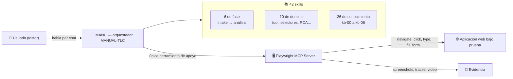
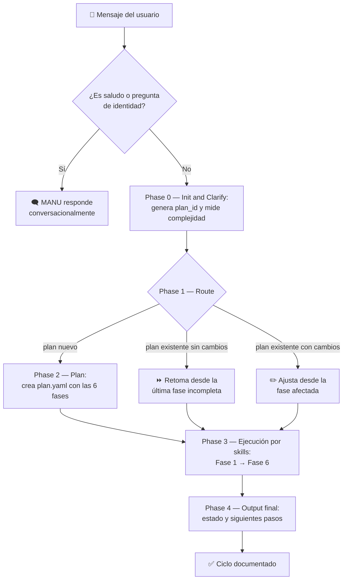
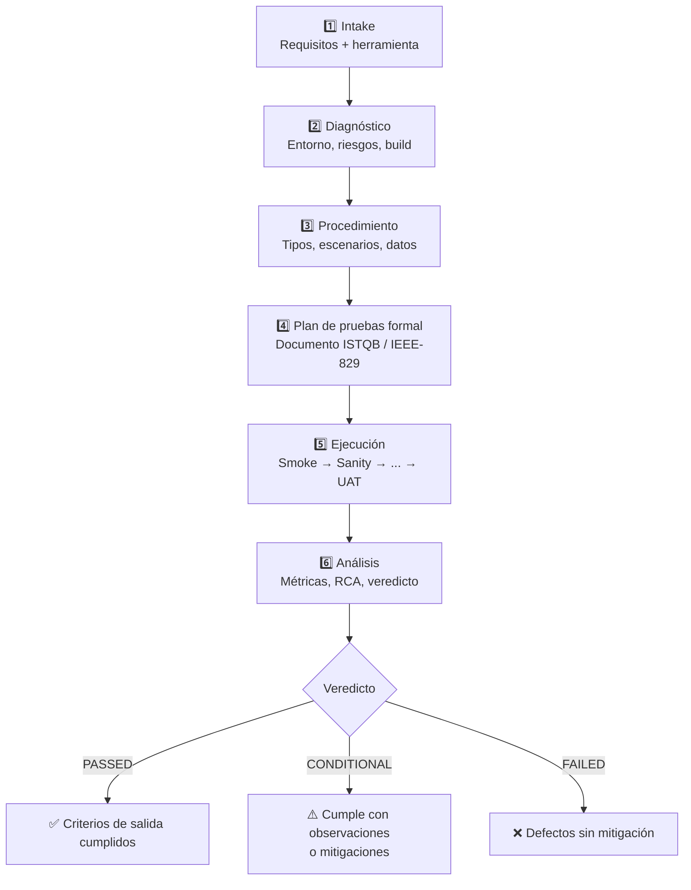
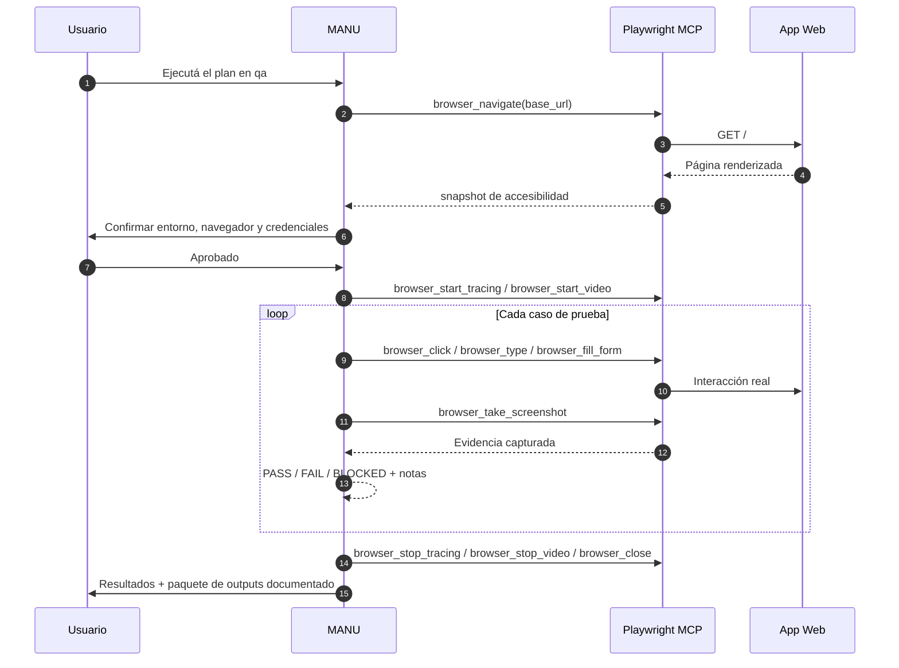
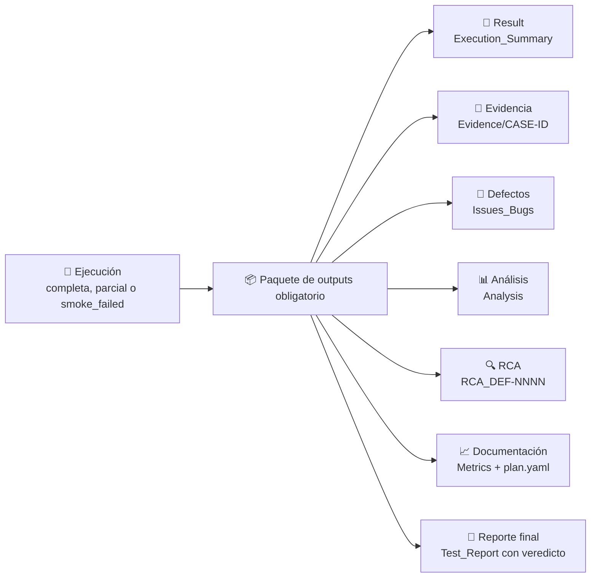

# 🧪 MANUAL-TLC v1.0 — Orquestador del Ciclo de Vida de Pruebas Manuales

> **MANUAL-TLC** es un agente de QA conversacional llamado **MANU** que acompaña todo el ciclo de pruebas **manuales** de un sistema web: desde la recopilación de requisitos hasta el reporte final con veredicto. Para navegar la aplicación real y capturar evidencia, MANU usa una única herramienta de apoyo: el **Playwright MCP Server**.

Este repositorio **no contiene código de aplicación**: es un *knowledge base + configuración de agente* para [Claude Code](https://code.claude.com/docs) — 1 agente orquestador, **42 skills** (6 de fase, 10 de dominio y 26 de conocimiento) y una base de conocimiento de testing manual.

## 🤖 ¿Qué hace MANU?

MANU no ejecuta tests automatizados: **te acompaña durante la prueba manual**. Conversa contigo para entender qué querés probar, arma el plan de pruebas, genera los casos (en formato ejecutable y BDD/Gherkin), conduce las sesiones paso a paso en el navegador real, captura evidencia (screenshots, trazas, video), registra los defectos y entrega un análisis final con métricas y veredicto.

- **Conversa y pregunta** — no asume nada: ambiente, credenciales y alcance se confirman contigo antes de tocar nada.
- **Conduce el navegador** — abre la app, navega, hace clic, completa formularios y captura evidencia vía MCP, siempre bajo tu supervisión y con tu confirmación para ejecutar.
- **Deja todo documentado** — cada corrida genera un paquete de outputs estandarizado; una corrida sin documentación no se considera completada.

## 🧪 Los 7 tipos de prueba que cubre

| Tipo | ¿Para qué sirve? |
|---|---|
| **Smoke Testing** | Chequeo mínimo de aceptación del build antes de probar nada más. Si falla, se detiene todo y se documenta. |
| **Sanity Testing** | Verificación puntual y enfocada de que un fix concreto funciona. |
| **Pruebas Funcionales** | Verificar que cada función se comporta como lo indican los requisitos funcionales. |
| **Pruebas de Sistema** | Validar el sistema completamente integrado de punta a punta contra los requisitos de sistema. |
| **Pruebas de Regresión** | Confirmar que los cambios no rompieron lo que ya funcionaba. |
| **Pruebas Exploratorias** | Aprender, diseñar y ejecutar a la vez, con charters y time-boxing (SBTM). |
| **Pruebas de Aceptación (UAT)** | Validación de negocio contra criterios de aceptación acordados, con acta y firma. |

## 🚀 Quick Start

**Prerrequisitos**

- [Claude Code](https://code.claude.com/docs) instalado
- **Node.js 18+** (para `npx`)
- Un navegador basado en Chromium/Chrome (el que maneja el Playwright MCP Server)

**Pasos**

1. Cloná el repositorio y abrilo con Claude Code desde su carpeta:

   ```bash
   cd MANUAL-TLC
   Claude Code
   ```

2. El agente por defecto ya es `MANUAL-TLC-orchestrator-manual` (MANU) y el Playwright MCP Server ya viene configurado en `.claude/settings.json`:

   ```json
   {
     "mcp": {
       "playwright": {
         "type": "local",
         "command": ["npx", "@playwright/mcp@latest"],
         "enabled": true
       }
     }
   }
   ```

3. Escribí tu primer mensaje, por ejemplo:

   > *"Quiero probar el checkout de mi ecommerce en el ambiente qa"*

MANU arranca por la Fase 1 (Intake) y te va preguntando lo que falte. No necesitás tenerlo todo resuelto: con una intención clara alcanza.

## 🏗️ Arquitectura

MANU es el único punto de entrada: **todo pasa por el orquestador**, que decide qué skill cargar y en qué orden. Las skills son autónomas — cada una opera con sus propias instrucciones embebidas y consulta la base de conocimiento `kb-*` cuando la necesita.



El orquestador también coordina agentes de soporte genéricos (investigación, planificación, revisión) para tareas complejas, y cierra cada respuesta informando el estado de la fase en curso.

## 🔁 Flujo de trabajo

Antes de arrancar, MANU hace un **identity check**: si tu mensaje es un saludo o una pregunta de identidad ("hola", "¿quién sos?"), te responde como asistente y no toca ningún plan. Si es una tarea, entra al ciclo:



La complejidad se clasifica en TRIVIAL (consulta puntual), LOW (una o dos fases sueltas) o MEDIUM/HIGH (ciclo completo, el flujo normal).

### Las 6 fases del ciclo

| # | Fase | Skill | Qué produce |
|---|------|-------|-------------|
| 1 | Recopilación de Requisitos | `manual-tlc-intake-manual` | Requisitos, alcance, ambiente y selección de la herramienta de apoyo |
| 2 | Diagnóstico Técnico | `manual-tlc-diagnostics-manual` | Readiness del entorno, riesgos y validación del build |
| 3 | Plan de Procedimiento | `manual-tlc-procedure-plan-manual` | Tipos de prueba, módulos, escenarios y estrategia de datos |
| 4 | Plan de Pruebas Formal | `manual-tlc-test-plan-manual` | Documento ISTQB/IEEE-829 + criterios de aceptación con umbrales numéricos |
| 5 | Ejecución de Sesiones Manuales | `manual-tlc-execution-manual` | Casos ejecutados, evidencia y registro de defectos |
| 6 | Análisis de Resultados | `manual-tlc-analysis-manual` | Métricas, RCA y reporte con veredicto |

El estado del plan vive en `PRJ-{proyecto}/{ambiente}/DOCs/Test_Plan/plan.yaml`: si volvés otro día y decís *"continuá el plan"*, MANU retoma desde la última fase incompleta.



Las fases no se saltean ni se reordenan: cada una depende del resultado de la anterior.

## 🎬 Anatomía de una sesión de ejecución

En la Fase 5, MANU **siempre** corre primero el Smoke Test: si falla, detiene todo y documenta el motivo (`smoke_failed`). Antes de tocar la aplicación real te pide confirmación de entorno, navegador y credenciales:



Si un caso falla, MANU captura screenshot, mensajes de consola y peticiones de red, y registra el defecto en `Issues&Bugs/` antes de continuar.

## 📦 Lo que obtenés en cada ejecución

Cada corrida — completa, parcial, fallida o interrumpida — cierra con un **paquete de outputs obligatorio**. Si falta una pieza, MANU no reporta la corrida como completada (base: `PRJ-{proyecto}/{ambiente}/`):

| # | Output | Dónde queda | Cuándo |
|---|--------|-------------|--------|
| 1 | **Result** — resumen de ejecución | `Test_Results/{fecha}/Execution_Summary.yaml` (+ `.md`) | Siempre, incluso si falló el smoke |
| 2 | **Evidencia** | `Test_Results/{fecha}/Evidence/{CASE-ID}/` | Cada caso ejecutado |
| 3 | **Registro de defectos** | `Issues&Bugs/{fecha}/Issues_Bugs_{fecha}.md` | Si hubo FAIL o BLOCKED |
| 4 | **Análisis** | `Test_Results_Analisis_&_RCA/{fecha}/Analysis_{fecha}.md` | Siempre (Fase 6) |
| 5 | **RCA** | `Test_Results_Analisis_&_RCA/{fecha}/RCA_{DEF-NNNN}.md` | Por cada defecto crítico; si no hay, "RCA: no aplica" queda documentado |
| 6 | **Documentación** | `DOCs/Metrics/Metrics_{fecha}.md` + `plan.yaml` actualizado | Siempre |
| 7 | **Reporte con veredicto** | `Test_Results_Analisis_&_RCA/{fecha}/Test_Report_...md` | Cierre del ciclo |



La evidencia no se duplica: se guarda una vez y el resto de los artefactos la referencia por ruta relativa.

## 🗂️ Dónde vive todo

```text
PRJ-{proyecto}/
└── {ambiente}/                          # local | dev | qa | staging | preprod | prod
    ├── DOCs/{TipoDocumento}/            # Test_Plan, Test_Strategy, Metrics, UAT...
    ├── Test_Cases/
    │   ├── TestScript/                  # casos manuales (TC-FUNC-003.md...)
    │   └── BDD/                         # escenarios Gherkin (.feature)
    ├── Test_Results/{fecha}/            # una carpeta por fecha de ejecución
    │   ├── Evidence/{CASE-ID}/          # screenshots, trazas, video
    │   └── Sessions/                    # reportes de sesiones exploratorias
    ├── Test_Data/                       # cuentas, datos y catálogo de selectores
    ├── Test_Results_Analisis_&_RCA/{fecha}/
    └── Issues&Bugs/{fecha}/
```

Reglas rápidas: los nombres de carpeta son fijos; las fechas van en ISO (`2026-09-21`) y las segundas corridas del mismo día usan sufijo `_r02`; no se escribe nada fuera de `PRJ-{proyecto}/{ambiente}/`.

## 🧾 Veredictos finales

- **PASSED** ✅ — todos los criterios de salida se cumplen por tipo de prueba.
- **CONDITIONAL** ⚠️ — criterios cumplidos con observaciones o defectos menores mitigados.
- **FAILED** ❌ — criterios no cumplidos sin mitigación; el registro de defectos y el RCA explican por qué.

## 💬 Frases que podés usar

| Querés… | Decí… |
|---|---|
| Empezar un ciclo nuevo | *"Quiero probar [sistema] en [ambiente]"* |
| Retomar donde quedó | *"Continuá el plan desde la fase 5"* |
| Solo un smoke | *"Hacé solo un smoke test de [URL] en staging"* |
| Validar un fix | *"Sanity del fix del módulo pagos en qa"* |
| Regresión | *"Ejecutá la regresión del módulo checkout en qa"* |
| Explorar | *"Corré una sesión exploratoria de 60 min sobre el carrito"* |
| UAT | *"Prepará el guion UAT del flujo de devoluciones"* |
| Analizar resultados | *"Analizá la corrida de hoy contra el baseline"* |
| Ver el estado | *"¿En qué fase está el plan?"* |
| Casos en Gherkin | *"Generá los escenarios BDD del módulo pagos"* |

## 🧩 Catálogo de skills (42)

**6 de fase** — las del ciclo: `manual-tlc-intake-manual`, `manual-tlc-diagnostics-manual`, `manual-tlc-procedure-plan-manual`, `manual-tlc-test-plan-manual`, `manual-tlc-execution-manual`, `manual-tlc-analysis-manual`.

**10 de dominio** — soporte transversal: estructura de carpetas del proyecto, selección de herramienta, estrategia de selectores XPath, workflow de sesión con Playwright MCP, workflow exploratorio, workflow de regresión, workflow UAT, estrategia de pruebas, análisis de métricas y diagnóstico RCA.

**26 de conocimiento** (`kb-00` a `kb-06`) — fundamentos, requisitos, datos de prueba, métricas, guía completa del Playwright MCP Server, tipos de prueba, técnicas de diseño de casos, estándares, gestión de defectos, entorno y ejecución, smoke/sanity, análisis y cierre, exploratorias, y más.

No tenés que pedirlas: MANU las carga solas según la fase y la necesidad.

## ⚙️ Reglas del juego (lo que MANU respeta siempre)

- **Una sola herramienta**: el Playwright MCP Server. Otra herramienta solo si la pedís explícitamente (y queda registrado el motivo).
- **Secuencial por defecto**: fases y casos en orden; paralelismo solo si lo solicitás (`parallel: true`).
- **Smoke primero**: siempre; si falla, no se continúa con los demás tipos.
- **Evidencia obligatoria**: un caso sin evidencia no puede reportarse como PASS.
- **Selectores XPath validados**: nada se usa sin validar unicidad y comportamiento en la sesión MCP; Chrome DevTools MCP está prohibido.
- **Plantillas obligatorias**: todo caso de prueba (generado, creado o importado) nace de las plantillas de `templates/` — `tc_template.md` para casos manuales, `bdd_template.md` para BDD y `tc_example.md` como ejemplo de referencia; los casos importados se normalizan a la plantilla.
- **Nunca toca producción** ni datos sensibles sin tu aprobación escrita explícita.
- **NFRs numéricos**: se fijan umbrales concretos (p. ej. "cargar en ≤ 3 s"), nunca "rápido" o "aceptable".
- **En español**: prompts, documentos y reportes se mantienen en español.

## 🆘 Problemas frecuentes

**El navegador no abre / no aparecen las herramientas `browser_*`**
El servidor MCP se carga al iniciar la sesión: reiniciá Claude Code. Para verificar, corré `npx @playwright/mcp@latest --version`.

**¿Puedo usar otra herramienta (Postman, Selenium, etc.)?**
Solo si lo pedís explícitamente en la conversación; MANU registrará el motivo en `selected_tool.rationale`.

**¿Dónde está mi plan?**
En `PRJ-{proyecto}/{ambiente}/DOCs/Test_Plan/plan.yaml`. Consultale el estado con *"¿En qué fase está el plan?"*.

**¿Puedo renombrar o borrar carpetas de `PRJ-...`?**
Mejor no: la estructura es estándar y los reportes la referencian. Si algo quedó mal ubicado, pedile a MANU que lo migre.

**La ejecución se cortó a mitad de la corrida**
No perdés nada: igual se genera el paquete de outputs (resumen con el estado de parada + análisis del motivo).

**¿Puedo correr dos sesiones a la vez?**
No recomendado: el navegador y el estado de la sesión MCP son compartidos. Una sesión a la vez.

---

*MANUAL-TLC v1.0 — hecho para testers que prueban de verdad. 🥇*