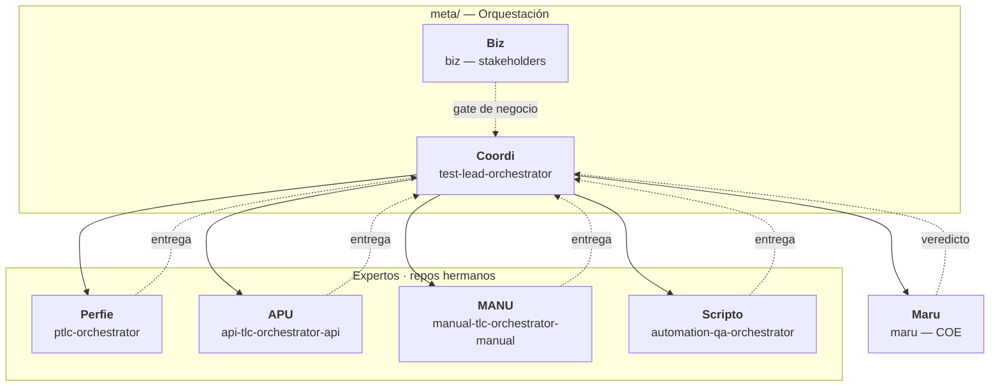
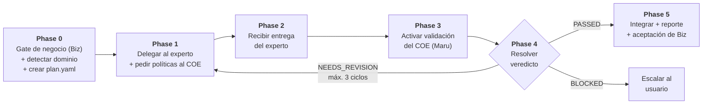
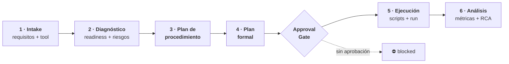
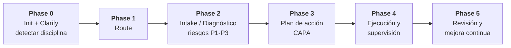
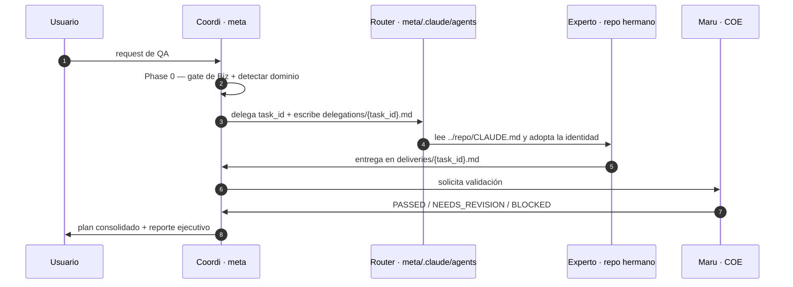

# QA-Agents-Ecosystem

**Ecosistema de QA cross-disciplina** — Orquestador + 4 expertos + COE + Stakeholders, sobre Claude Code.

---

## 🎯 Visión General

Este repositorio contiene un **ecosistema completo de agentes de QA** que trabajan coordinados para
cubrir todo el ciclo de vida de testing: manual, automatización, API, performance y gobernanza.

No es un monorepo de código: es un **ecosistema de agentes**. Cada disciplina vive en su propio
subproyecto, con su `CLAUDE.md`, sus agentes en `.claude/agents/` y su knowledge base en
`.claude/skills/`. `meta/` no ejecuta pruebas — orquesta, delega, valida e integra.

**Principio de diseño:** el conocimiento no se duplica. Un experto es dueño de su dominio; `meta/`
solo lo invoca y consolida. El COE (`Maru`) es el único árbitro de gobernanza, independiente de
todos.



---

## 👥 El Crew

| Área | Friendly | Agente técnico | Repo | Definición | Skills |
|---|---|---|---|---|---|
| **Stakeholders** | **Biz** | `biz` | `meta/` | `.claude/agents/biz.md` | — |
| **Orquestador** | **Coordi** | `test-lead-orchestrator` | `meta/` | `.claude/agents/test-lead-orchestrator.md` | 5 |
| **Performance Test** | **Perfie** | `ptlc-orchestrator` | `Intelligent_Performance_Test_Orchstrator/` | `.claude/agents/ptlc-orchestrator.md` | 18 |
| **API Test** | **APU** | `api-tlc-orchestrator-api` | `API-TLC/` | `.claude/agents/api-tlc-orchestrator-api.md` | 22 |
| **Manual Test** | **MANU** | `manual-tlc-orchestrator-manual` | `MANUAL-TLC/` | `.claude/agents/manual-tlc-orchestrator-manual.md` | 42 |
| **Automation Test** | **Scripto** | `automation-qa-orchestrator` | `AUTO-TLC/` | `.claude/agents/automation-qa-orchestrator.md` | 17 |
| **COE / Governance** | **Maru** | `maru` | `COE/` | `.claude/agents/maru.md` | 14 |

**Cómo se invoca un agente:** cada uno vive en el `.claude/agents/` de su repo y se lanza con
`@agent-<nombre>` o `claude --agent <nombre>`. El entry point de cada repo está declarado en su
`CLAUDE.md`.

### Regla de identidad (obligatoria para todos los agentes)

Todos los agentes responden a su nombre y personalidad **con independencia del proveedor de IA**:

> Cada agente se presenta como **Coordi / Biz / Perfie / APU / MANU / Scripto / Maru** y explica su
> rol. Nunca se identifica con el proveedor de IA ni con el nombre del modelo subyacente — el modelo
> es un componente de infraestructura y no forma parte de la identidad conversacional del agente.

---

## 🔄 Flujo Principal — Pipeline de Coordi

**`test-lead-orchestrator` (Coordi) es el entry point obligatorio**: todo request entra por él.
Ninguna tarea de QA se resuelve dentro de `meta/`.



### Detección de dominio (Phase 0)

| Señal en el request | Disciplina |
|---|---|
| Objetivo de carga / latencia / throughput | **performance** → Perfie |
| "automatizar" como verbo, CI/CD, selectores | **automation** → Scripto |
| Contratos, endpoints, esquemas, sin carga | **api** → APU |
| Evidencia, UAT, exploración, pasos manuales | **manual** → MANU |
| Varias disciplinas | **hybrid** → varios expertos |

En `hybrid`, el orden de intervención es fijo: **performance** (define NFRs) → **api** (contratos) →
**manual** (UAT/exploración) → **automation** (automatiza lo ya validado).

### Reglas de oro

- ✅ **Stakeholders siempre** — Phase 0 (brief de `Biz`) y Phase 5 (su `ACCEPTED`) son obligatorios.
  Sin brief no se delega; sin `ACCEPTED` no se cierra.
- ✅ **Delegación obligatoria** — ninguna tarea de QA se resuelve en `meta/`; siempre va a ≥1 experto.
- ✅ **No operar** — Coordi no prueba, Maru no implementa, Biz no testea.
- ✅ **Un `plan_id` maestro** en `meta/` (`YYYYMMDD-nombre-sistema`); cada experto genera el suyo y lo
  vincula con `meta_plan_id` + `task_id`.
- ✅ **Handoff por disco** — el contrato en `delegations/{task_id}.md` es la fuente de verdad: sin
  contrato escrito no hay delegación.
- ✅ **Approval Gate** — nada contra sistemas reales sin aprobación explícita del usuario. El
  silencio no es aprobación.
- ✅ **Cierre técnico ≠ cierre de negocio** — `PASSED` del COE y `ACCEPTED` de `Biz` son gates
  independientes; si `Biz` rechaza, se reabren las tareas afectadas.

---

## 🧪 Los Expertos y sus Ciclos

Cada experto implementa un ciclo de **6 fases** sobre su propia disciplina. La estructura es la
misma en las cuatro: una skill por fase, cargada solo cuando esa fase se ejecuta.



El **Approval Gate** va entre las fases 4 y 5: sin aprobación explícita del usuario, la ejecución no
corre. Es el punto donde el ciclo toca sistemas reales.

| Experto | Ciclo | Skills de fase | Veredicto que emite | Estado del plan |
|---|---|---|---|---|
| **Perfie** | PTLC (Performance Test Life Cycle) | `ptlc-intake`, `ptlc-diagnostics`, `ptlc-procedure-plan`, `ptlc-test-plan`, `ptlc-execution`, `ptlc-analysis` | `PASSED / FAILED` | `docs/plan/{plan_id}/plan.yaml` |
| **APU** | API-TLC | `api-tlc-intake-api`, `api-tlc-diagnostics-api`, `api-tlc-procedure-plan-api`, `api-tlc-test-plan-api`, `api-tlc-execution-api`, `api-tlc-analysis-api` | `PASSED / CONDITIONAL / FAILED` | `tests/{App}/{Env}/{Tool}/{plan_id}/plan.yaml` |
| **MANU** | MANUAL-TLC | `manual-tlc-intake-manual`, `…-diagnostics-manual`, `…-procedure-plan-manual`, `…-test-plan-manual`, `…-execution-manual`, `…-analysis-manual` | `PASSED / CONDITIONAL / FAILED` | `PRJ-{proyecto}/{ambiente}/DOCs/Test_Plan/plan.yaml` |
| **Scripto** | AUTO-TLC | `auto-tlc-intake`, `auto-tlc-diagnostics`, `auto-tlc-procedure-plan`, `auto-tlc-test-plan`, `auto-tlc-execution`, `auto-tlc-analysis` | `PASSED / CONDITIONAL / FAILED` | `automation-plans/{plan_id}/plan.yaml` |

### Bloqueos que detienen un ciclo

| Experto | Condición de parada |
|---|---|
| **Perfie** | Sin `execute: true` aprobado → `skipped_execution` |
| **APU** | El smoke test falla → se detiene antes de la corrida completa |
| **MANU** | Sin evidencia (screenshot/trace/log) un caso no puede reportarse `PASS`; sin `smoke` verde no avanza |
| **Scripto** | `readiness_score < 50` en fase 2 detiene el ciclo; smoke rojo en fase 5 detiene la ejecución |

### Especificidades por disciplina

- **Perfie** — single-tool por defecto (k6, JMeter, Gatling, Locust). Modela el workload
  (VUs, TPS, arriving rate) antes de scriptear. Catálogo de herramientas en
  `.claude/skills/ptlc-herramientas/`.
- **APU** — single-tool por defecto (RestSharp, Karate, Playwright, REST Assured). 3 modos de
  análisis: `individual`, `vs_baseline`, `vs_other_runs`. Plan state **obligatoriamente** bajo
  `tests/{App}/{Env}/{Tool}/`, nunca en `docs/`. Ver `PROJECT_STRUCTURE.md`.
- **MANU** — sesiones manuales asistidas por el **Playwright MCP Server**; XPath obligatorio y
  selectores validados contra el DOM real (`snapshotLength === 1`). Chrome DevTools MCP está
  prohibido. Todo caso nace de las plantillas de `templates/` (read-only). Todo run —incluso
  `smoke_failed`— cierra con el paquete de salida obligatorio.
- **Scripto** — `automation-rules` (reglas A1-A9 y gates) se carga **antes** de generar cualquier
  artefacto; si un gate falla, el estado es `BLOCKED`. Tags obligatorios
  (`@project @environment @functionality @specific_case`) y selectores capturados con
  Chrome DevTools MCP.

---

## 🏛️ Gobernanza — COE Maru

`Maru` es el **Center of Excellence**: independiente de todos los orquestadores, no referencia ni
carga agentes externos. No ejecuta ni implementa nada — emite políticas y valida.



**Disciplinas que cubre:** API · Manual · Automation · Performance · Accessibility · Procesos (SDLC)
· Auditoría. Carga la sub-skill de la disciplina **solo cuando se necesita** y solo la sección
requerida.

**Veredictos:** `PASSED / NEEDS_REVISION / BLOCKED`. (El contrato completo está en
[`meta/docs/governance/coe-reviewer.md`](meta/docs/governance/coe-reviewer.md).)

**Base normativa:** ISO/IEC 25010:2023, ISO/IEC/IEEE 29148, ISO 9001, ISO 27001, ISTQB, CMMI, TMMi,
DAMA-DMBOK, DevSecOps.

---

## 🚧 Gates del Sistema

| Gate | Dónde | Qué exige |
|---|---|---|
| **Gate de negocio (Biz)** | Phase 0 del pipeline | Brief de negocio con objetivo, alcance, prioridades y criterios de aceptación. Sin brief, `Coordi` **no delega**. |
| **Approval Gate** | Fase 4→5 de cada experto | Aprobación explícita del usuario antes de ejecutar contra sistemas reales. El silencio no es aprobación. |
| **Validación del COE** | Phase 3 del pipeline | Ninguna entrega se integra sin veredicto de `Maru`. |
| **Aceptación de negocio (Biz)** | Phase 5 del pipeline | `ACCEPTED` sobre el reporte ejecutivo. Un criterio de la brief sin evidencia → `REJECTED`. |
| **Gate de gobernanza** | Acciones del COE | Cambios a estándares o políticas requieren aprobación explícita del usuario. |

---

## 📦 Estado Compartido y Artefactos

### `meta/` — plan maestro

Todo bajo `docs/plan/{plan_id}/`:

| Artefacto | Contenido |
|---|---|
| `plan.yaml` | Plan maestro: fases, delegación, gate de stakeholder, estado |
| `stakeholder_brief.md` | Brief de negocio de `Biz` + veredicto de aceptación |
| `context_envelope.json` | Contexto acumulado por fase |
| `discussion.md` | Diálogo entre pares (dependencias cruzadas) |
| `coe_review.md` | Políticas del COE + veredictos |
| `combined_test_plan.md` | Plan integrado de todos los expertos |
| `executive_report.md` | Reporte ejecutivo final |
| `delegations/{task_id}.md` | Contrato de tarea enviado al experto |
| `deliveries/{task_id}.md` | Entrega del experto |
| `validation/{task_id}.json` | Veredicto del COE |

### Cada experto

| Repo | Estado del plan | Artefactos de ejecución |
|---|---|---|
| **AUTO-TLC** | `automation-plans/{plan_id}/` | `tests/`, selectores validados, reportes de suite |
| **API-TLC** | `tests/{App}/{Env}/{Tool}/{plan_id}/` | scripts, test data, reportes y RCA |
| **MANUAL-TLC** | `PRJ-{proyecto}/{ambiente}/` | evidencia, defectos, análisis, métricas |
| **Performance** | `docs/plan/{plan_id}/` | `tests/performance/{tool}/`, plan y reporte |
| **COE** | `docs/qa-governance/{plan_id}/` | auditoría, checklist, plan de mejora |

**Context envelope:** cada fase persiste su bloque en `context_envelope.json`. Las fases siguientes
lo cargan y **no releen** lo ya sintetizado — así el costo de contexto no crece con el ciclo.

---

## 🛠️ Skills — Patrón de 3 Niveles

```
Nivel 1: .claude/skills/README.md          → Índice maestro (catálogo completo)
Nivel 2: .claude/skills/<skill>/SKILL.md   → Rol, workflow, reglas, formato de salida
Nivel 3: <skill>/NN_Tema.md                → Contenido autoritativo (fórmulas, umbrales, ejemplos)
```

**Reglas de lectura:**
1. Consultar el índice (Nivel 1) antes que un documento.
2. Leer el Nivel 2 antes de editar un Nivel 3.
3. Nunca leer completo un documento >2.000 tokens: localizar la sección
   (`grep -n "^## "`) y leer por offset/limit.
4. No duplicar: actualizar el documento existente y dejar el puntero en la skill.

### Presupuesto de tokens

| Artefacto | Límite |
|---|---|
| Contexto siempre activo (descripciones + `CLAUDE.md` + settings) | ≤ 1.400–1.500 |
| Cuerpo de un agente | ≤ 3.200 |
| `SKILL.md` (Nivel 2) | ≤ 2.000 |
| Documento de detalle (Nivel 3) | ≤ 6.000 |

Perfie mide esto automáticamente:
`python scripts/measure_tokens.py --strict` (falla con exit 1 si se supera un presupuesto).

---

## 🌐 Invocación Cross-Repo

Claude Code no puede cargar agentes ni skills de otro repositorio desde configuración. Por eso, en
`meta/.claude/agents/` viven **5 subagentes router** que leen la definición canónica del repo
hermano por ruta relativa y adoptan esa identidad antes de operar.



| Router en `meta/.claude/agents/` | Repo hermano |
|---|---|
| `ptlc-orchestrator.md` (Perfie) | `../Intelligent_Performance_Test_Orchstrator` |
| `api-tlc-orchestrator-api.md` (APU) | `../API-TLC` |
| `manual-tlc-orchestrator-manual.md` (MANU) | `../MANUAL-TLC` |
| `automation-qa-orchestrator.md` (Scripto) | `../AUTO-TLC` |
| `maru.md` (COE) | `../COE` |

El acceso a las carpetas hermanas se declara en `meta/.claude/settings.json`:

```json
{
  "permissions": {
    "allow": ["Agent", "Skill"],
    "additionalDirectories": ["..", "../API-TLC", "../AUTO-TLC", "../COE", "../MANUAL-TLC", "../Intelligent_Performance_Test_Orchstrator"]
  }
}
```

Como alternativa de máxima fidelidad, el experto puede lanzarse con su cwd en su propio repo:

```bash
cd ../MANUAL-TLC && claude --agent manual-tlc-orchestrator-manual \
  -p "Lee el contrato ../meta/docs/plan/{plan_id}/delegations/{task_id}.md y ejecuta tu ciclo de 6 fases."
```

---

## 📁 Estructura del Repositorio

Todos los subproyectos comparten la misma forma: `CLAUDE.md` + `.claude/agents/` + `.claude/skills/`
+ `.claude/settings.json` (y `.mcp.json` donde hay MCP).

```
QA-Agents-Ecosystem/
├── meta/                                     # Orquestador principal (Coordi + Biz)
│   ├── .claude/agents/                       # Coordi, Biz + 5 routers cross-repo
│   ├── .claude/skills/                       # 5 skills de orquestación
│   ├── docs/governance/coe-reviewer.md       # Contrato de revisión del COE
│   ├── docs/plan/{plan_id}/                  # Artefactos del plan maestro
│   ├── CLAUDE.md                             # Guía persistente del ecosistema
│   ├── DESIGN_INTEGRATION_PLAN.md            # Diseño de integración
│   └── .claude/settings.json                 # Permisos + acceso a repos hermanos
│
├── COE/                                      # Center of Excellence (Maru)
│   ├── .claude/agents/maru.md
│   ├── .claude/skills/                       # 14 skills de gobernanza
│   ├── docs/qa-governance/_plantilla/        # Plantillas base de gobernanza
│   ├── CLAUDE.md
│   └── .claude/settings.json
│
├── AUTO-TLC/                                 # Automation Test (Scripto)
│   ├── .claude/agents/automation-qa-orchestrator.md
│   ├── .claude/skills/                       # 17 skills (6 fases + 11 apoyo)
│   ├── docs/knowledge/Automation_QA/         # Knowledge base estructurado
│   ├── docs/templates/                       # tc_template.md, tc_example.md
│   ├── utils/validate_encoding.py            # Validación UTF-8
│   ├── PROJECT_STRUCTURE.md
│   ├── CLAUDE.md
│   ├── .mcp.json                             # Playwright + Chrome DevTools MCP
│   └── .claude/settings.json
│
├── API-TLC/                                  # API Test (APU)
│   ├── .claude/agents/api-tlc-orchestrator-api.md
│   ├── .claude/skills/                       # 22 skills (6 fases + 16 apoyo)
│   ├── tests/{App}/{Env}/{Tool}/{plan_id}/   # Estado de planes (obligatorio)
│   ├── PROJECT_STRUCTURE.md
│   ├── CLAUDE.md
│   └── .claude/settings.json
│
├── MANUAL-TLC/                               # Manual Test (MANU)
│   ├── .claude/agents/manual-tlc-orchestrator-manual.md
│   ├── .claude/skills/                       # 42 skills (6 fases + workflows + kb-*)
│   ├── templates/                            # tc_template.md, bdd_template.md, tc_example.md
│   ├── PRJ-{proyecto}/{ambiente}/            # Estructura gobernada de artefactos
│   ├── CLAUDE.md
│   ├── .mcp.json                             # Playwright MCP
│   └── .claude/settings.json
│
└── Intelligent_Performance_Test_Orchstrator/ # Performance Test (Perfie)
    ├── .claude/agents/ptlc-orchestrator.md
    ├── .claude/skills/                       # 18 skills (6 fases + apoyo)
    ├── docs/                                 # Documentación técnica 01–09
    ├── docs/plan/{plan_id}/                  # Planes de performance
    ├── tests/performance/{tool}/             # Scripts generados
    ├── scripts/measure_tokens.py             # Medidor de presupuesto de tokens
    ├── CLAUDE.md
    └── .claude/settings.json
```

---

## 🚀 Cómo Usar

### Desde `meta/` — punto de entrada recomendado

```bash
cd meta
claude -p "Necesito testear la API de pagos del e-commerce ShopPolymer"
```

Coordi abrirá con el gate de **Biz**, detectará el dominio (API), delegará en **APU** (API-TLC),
pedirá políticas a **Maru** (COE) y cerrará con la aceptación de **Biz**.

### Directo a un experto — consultas puntuales

```bash
cd AUTO-TLC && claude -p "¿Cómo aplico Page Object Model en Playwright?"
cd API-TLC && claude -p "Genera matriz de pruebas desde este OpenAPI"
cd MANUAL-TLC && claude -p "Crea casos de prueba para login con BDD"
cd Intelligent_Performance_Test_Orchstrator && claude -p "Diseña workload model para 1000 users"
cd COE && claude -p "Audita el plan de automatización actual"
```

### Sesión directa con un agente

```bash
claude --agent maru          # sesión completa como Maru, desde COE/
```

---

## 📋 Plantillas Obligatorias

| Repo | Plantillas | Ubicación |
|---|---|---|
| **AUTO-TLC** | `tc_template.md`, `tc_example.md` | `docs/templates/` |
| **MANUAL-TLC** | `tc_template.md`, `bdd_template.md`, `tc_example.md` | `templates/` (root, read-only) |
| **COE** | `plan.yaml`, `context_envelope.json`, `qa-quality-plan.md`, `governance-checklist.md`, `audit-report.md`, `improvement-plan.md` | `docs/qa-governance/_plantilla/` |

---

## 🏷️ Convenciones

- **Idioma primario:** español (términos técnicos en English).
- **Encoding:** UTF-8 obligatorio — `python utils/validate_encoding.py` (AUTO-TLC).
- **Skills:** frontmatter `name` + `description` en todo `.claude/skills/<n>/SKILL.md`.
- **Agentes:** frontmatter `name` + `description` en todo `.claude/agents/<n>.md`. Sin ambos, Claude
  Code ignora el archivo en silencio.
- **Estado del plan:** cada experto persiste en su propia estructura (`automation-plans/`,
  `tests/...`, `PRJ-...`, `docs/plan/`) — nunca dentro de `.claude/`.
- **NFRs numéricos:** nada de "rápido" o "aceptable"; umbrales concretos (p95 ≤ 200 ms, error ≤ 1%).

---

## 🤝 Contribuir

1. Cada experto es autónomo: respeta su `CLAUDE.md`, sus skills y su ciclo de vida.
2. No dupliques conocimiento: actualiza el `docs/` del repo dueño y deja el puntero en la skill.
3. Sigue el patrón de 3 niveles para skills.
4. Mantén los presupuestos de tokens (agente ≤3.2K · `SKILL.md` ≤2K · detalle ≤6K).
5. Al renombrar o mover un archivo, actualiza las referencias en el `README.md` del índice de skills
   y en el `SKILL.md` padre.

## 📖 Documentación Adicional

- [`meta/DESIGN_INTEGRATION_PLAN.md`](meta/DESIGN_INTEGRATION_PLAN.md) — diseño completo del ecosistema
- [`meta/CLAUDE.md`](meta/CLAUDE.md) — guía persistente del orquestador
- [`meta/docs/governance/coe-reviewer.md`](meta/docs/governance/coe-reviewer.md) — contrato de revisión del COE
- `CLAUDE.md` de cada repo — guía específica del agente
- `Intelligent_Performance_Test_Orchstrator/docs/09-guia-reproduccion-sistema-fases.md` — guía para
  reproducir el patrón de un ecosistema de agentes desde cero

---

*QA-Agents-Ecosystem — Orquestación cross-disciplina de testing. Platform: Claude Code.*
